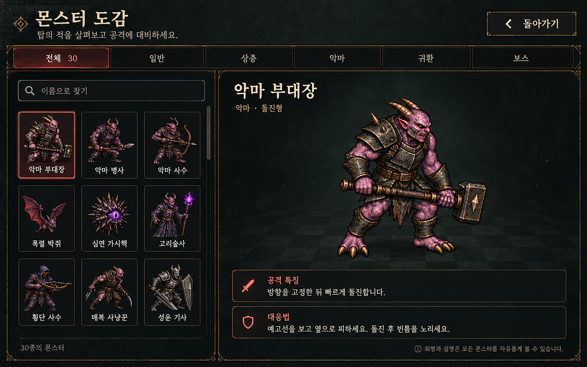

# 메인 몬스터 도감 화면 설계 v1

2026-10-15 · 디자인 승인 대기 · runtime 미반영

## 목적과 진입

메인 메뉴 보조 버튼에 몬스터 도감을 추가한다. 저장된 도전이 없어도 30종 모두 열람한다. 기존 journalMarkup(s)은 이번 원정의 목격·처치 기록을 계속 담당한다. 도감은 원정을 시작하거나 기존 저장을 교체하지 않고 읽기 전용으로 동작한다. 설정 진입보다 메인 직접 진입을 우선 제안한다. 필요하면 일시정지에서도 같은 도감을 열고 원래 화면으로 복귀한다.

## 화면

전체/일반/상층/악마/귀환/보스 분류, 이름 검색, 선택 가능한 초상 카드 목록. 상세에는 큰 외형·이름·분류/역할·공격 특징·대응법을 표시한다. 미목격 잠금은 두지 않는다. 빈 검색은 결과 없음과 검색 초기화를 안내한다. 선택 카드 표시·버튼 키보드 조작·검색 입력 라벨·초상 대체 텍스트를 제공한다. 좁은 화면은 목록 위/상세 아래로 배치하고 스크롤을 허용한다. 가로 게임 화면에서도 닫기 버튼을 찾기 쉽게 둔다.

## 데이터와 자산

enemyGuide와 기존 renderJournalPortraits의 승인된 runtime 초상을 재사용한다. 상세 행동 설명은 실제 코드와 일치하게 작성하고 대응법을 분리한다. 시안의 작은 카드 그림은 생성 모델의 구성 예시로 기존 승인 캐릭터와 다르므로 채택하지 않는다. 새 캐릭터 디자인이나 새 runtime PNG를 만들지 않는다. 상세 선택 시 ready 이후 초상을 갱신하고 fallback을 유지한다. 대악마는 기존 손/발/눈/코/입/본체 선택을 확장해 보여주며, 다른 다단계 보스는 기존 초상 범위부터 제공한다. 미구현 형태 선택을 만들어 두지 않는다.

## 승인 후 구현 범위

메인 진입/닫기 복귀·독립 도감 UI 모듈·상세 데이터·분류/검색/선택·반응형 스타일·기존 초상 재사용을 한 단위로 연결한다. 원정 데이터 변경 없음. 현재 이미지와 문서만 준비했다. 사용자 AGENTS.md의 '디자인 변경은 시안을 먼저 보여주고 사용자 컨펌을 받은 안만 구현' 규칙에 따라 구성 승인 후 runtime에 반영한다. 테스트·브라우저QA·푸시·배포·공개 확인은 새 명시 배포 지시까지 실행하지 않는다.

## 승인 후 구현
- [메인 몬스터 도감 승인안 로컬 구현 완료 / 미검증] 2026-10-15 ㄱㄱ승인. 메인 몬스터 도감 버튼→독립 bestiary 모드/닫기·ESC 복귀. src/ui/bestiary.js 전체30종·6분류·이름검색(공백무시)·선택표시·빈결과/검색초기화·큰기존초상·공격특징(enemyGuide)·개별대응법·대악마6부위 선택 연결. 기존renderJournalPortraits ready/cache/fallback 재사용·원정/저장변경없음/새PNG없음. styles/bestiary.css 넓은화면좌우/좁은화면상하·전체화면스크롤·터치/키보드포커스·safe-area, 전역모바일header충돌을div로회피. index스타일연결/공개QA파일목록준비만(서버배포정규식허용범위). 정적diff소스검토만/테스트브라우저QA푸시배포공개확인없음. 실제메뉴진입·無저장30종·검색분류·ESC/Tab·모바일스크롤·초상ready지연/fallback·대악마부위·저장불변·説明정합성은미검증. 생성시안작은카드는사용하지않고기존승인초상사용. 운영release-20261014-201910-449d0e유지. 현재도감모듈스타일/game/index/QA목록/설계4기록수정/실행중세션차단없음. 다음로컬커밋후요청수정 또는새명시배포때누적검증.
