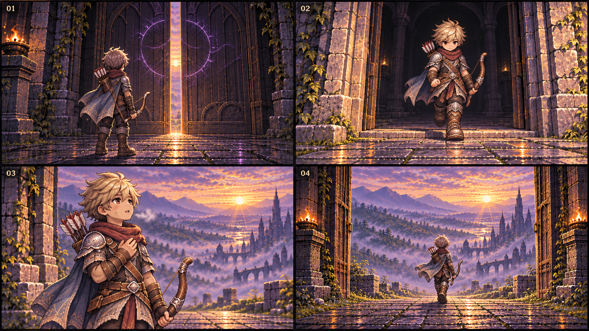

# 엔딩 품질 개선 — 생환의 아침

2026-11-21 사용자 ‘엔딩씬도 다듬자’ 요청. **통합 시안·승인 전**이며 런타임/배포 자산에 반영하지 않았다. 기존 프롤로그와 주인공·장비·고딕 석조/새벽 색을 맞춘다.

## 현재 코드와 개선 방향

`src/ui/escape-scene.js`는 3초 동안 타이틀용 3프레임 인물의 위치·크기를 바꾸고 문을 수평 이동한다. 배경/별도 문·스킵·결과 기록 보호는 이미 있으며 새 기능으로 다시 세지 않는다. 이번은 실제 발 접지와 몸의 행동, 멈춤 뒤 숨, 출발의 여운을 보강하는 제안이다.

|구간|화면과 실제 행동|별도 연출·음향|
|---|---|---|
|0~1.2초|안쪽에서 문을 바라본다. 마지막 봉인 선이 끊기고 좁은 틈이 열린다.|문 표면의 얇은 빛이 사라짐·빗장 해제/낮은 문 삐걱임|
|1.2~3초|바깥 역방향 카메라. 주인공이 문턱을 넘어 앞발을 딛고 뒤발을 뗀다.|발 접지에 맞춘 두 걸음·망토/장비 후행·새벽 테두리광|
|3~4.8초|문밖에서 멈춘다. 활을 낮추고 어깨를 풀며 오른손으로 가슴 끈을 짚고 짧게 숨을 돌린다.|호흡과 시선 변화·작은 바람 소리·카메라 고정|
|4.8~7초|등을 보이며 탑 바깥 귀환길로 한두 걸음 출발한다. 인물은 작게, 새벽 풍경은 넓게 둔다.|망토 바람·발소리 후 잦아듦·‘살아서 내려왔다.’ 4.9~6.85초|

추천 정서는 지친 안도와 돌아가려는 결심이다. 승리 포즈·폭발·탑 붕괴·모든 저주 해소·새 NPC/동료 구출을 추가하지 않는다. 고전/확장 모두 가능한 생환 연출이며 결과의 선택형 후일담은 기존 모드 분기를 유지한다. 프롤로그의 닫힌 문과 엔딩의 열린 문을 대응시킨다.

## 시안의 한계와 구현 패키지

- 보드는 네 개의 **키포즈**이지 완성 애니메이션이 아니다. 동일 이미지를 확대/이동하는 방식으로 끝내지 않는다.
- 원화에서 후면 01/04의 활 손은 반대쪽으로 읽힐 여지가 있다. 제작 시 승인된 앞모습의 **왼손 활·오른손 끈**을 기준으로 후면/측면까지 고정한다. 컷별 장비/문 경첩·태양 방향도 동일 공간에 맞춰 정리한다.
- 승인 후 배경 2장 내외(봉인 안쪽/문밖 역각), 기존 새벽 전경 재사용, 인물 문턱 보행/정지/숨/고개/출발 연결 프레임을 한 패키지로 제작한다. 접지점·키/체격·관절 연결을 함께 맞춘 뒤 묶어서 검토한다. 보드 이미지를 그대로 배포용 배경으로 사용하지 않는다.
- 인물·그림자·문·봉인·빛은 분리한다. 오라/광원은 인물 PNG에 박지 않는다. 문은 경첩 기준 회전·아치 가림을 쓰며 좌우로 밀어 없애지 않는다.
- 완화 효과는 카메라/과한 빛·먼지를 줄이되 동작 키포즈와 자막을 유지한다. 하단 자막·우측 스킵은 모바일 안전영역을 확보한다.

## 저장·실패·검증 경계

`finish(won)`의 기록·랭킹 완료 뒤 표시하는 구조, 재생 토큰/반복 방지, 키보드/버튼 스킵, blur/회전/pagehide/오류시 결과 복귀를 유지한다. 연출 때문에 원정 시간·점수·버프/보상이 바뀌면 안 된다. 기존0.8초 준비 대기는 늘리지 않고 1층 귀환 때 사전 준비하는 정책 안에서 자산을 준비한다. 새 자산이 없거나 늦으면 즉시 기존 결과 화면으로 간다.

이번에는 이미지 생성·코드 읽기·정적 문서 검토만 진행했다. 테스트/구문 실행·서버/브라우저·푸시/배포는 하지 않았다. 승인 후 구현·기록·로컬 커밋, 별도 배포 지시 때 전체/API 및 생환17케이스·신규7초 모션/자막/완화·모바일 cold/warm/저장 1회 검증으로 이어간다.

## 생성 이력

- 내장 `image_gen` 사용, 참조: `entrance-hero-frontwalk-v3.png`(주인공)·`escape-dawn-v1.png`(새벽 배경). 두 파일을 직접 열어 확인한 뒤 생성.
- 원본: `C:/Users/SDSPRO/.codex/generated_images/01a1bb35-6f0c-7421-914b-8beb67028949/exec-8965082c-cf84-4752-85bb-b92594aeba05.png`. 원본은 보존하고 `storyboard-v1.png`로 무변환 복사했다.
- 정확한 생성 프롬프트: [prompt-v1.txt](prompt-v1.txt). 생성된 주인공의 미세한 외형/활 손 차이는 승인된 기본 디자인을 덮어쓰는 근거가 아니다.

- 복사본 SHA256: 
  3DB1075DFDE48E8A6A3752CF66D2C6CBFB336CA4226F8867A8E6334763A96B71
