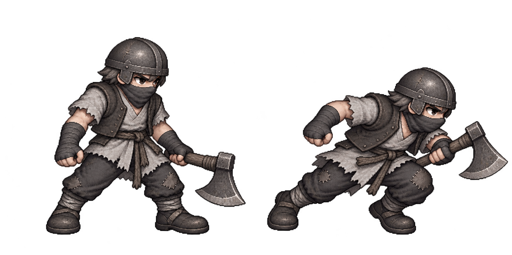
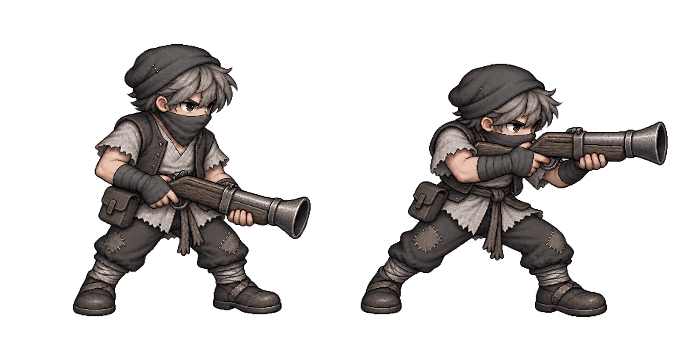
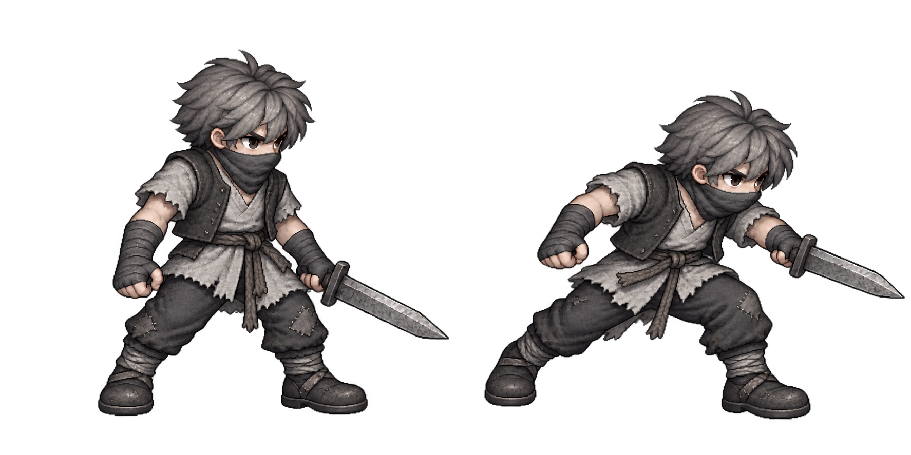
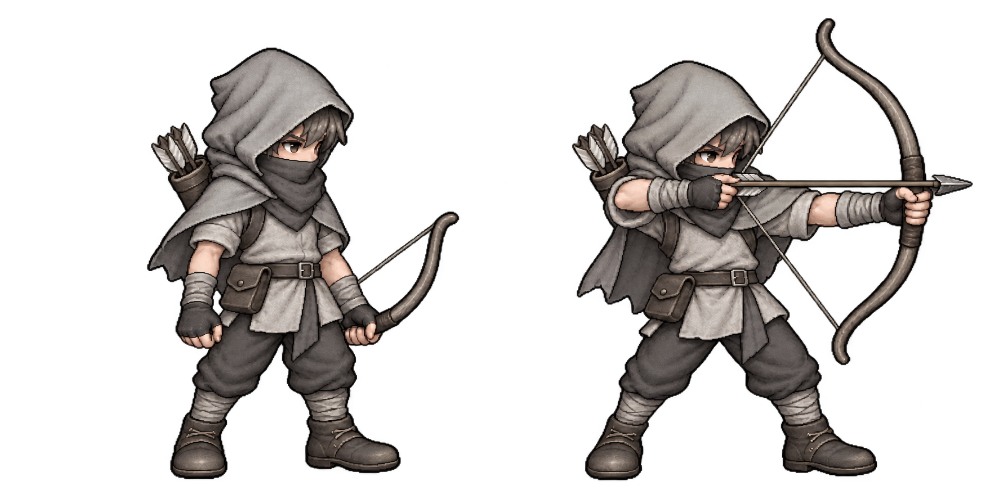
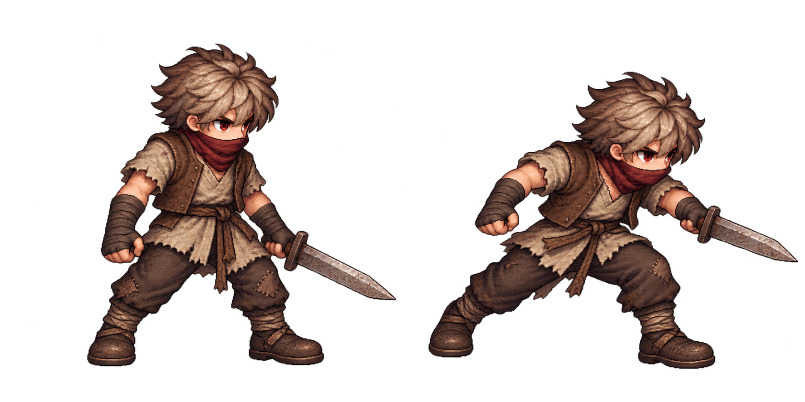
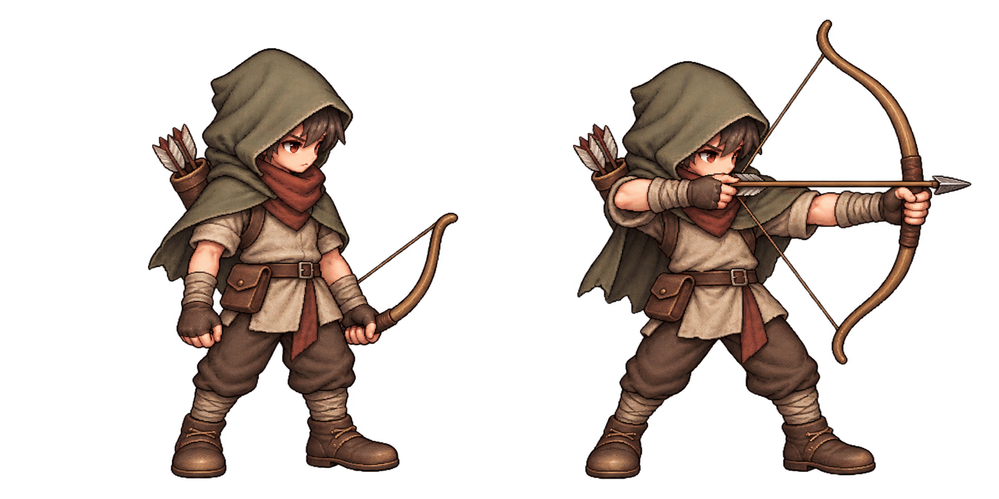
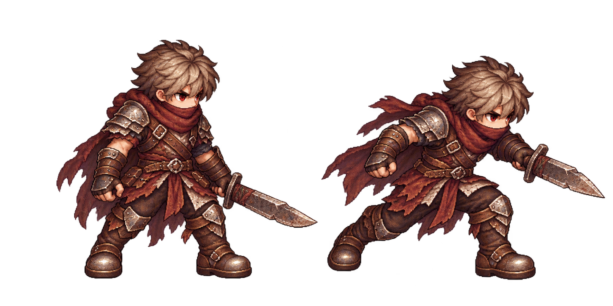
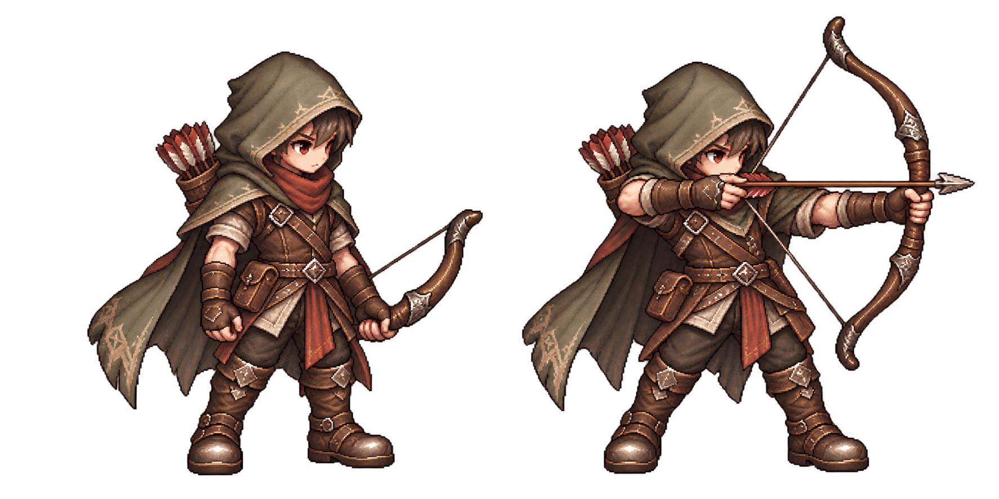

# 다음 시안 — 돌진병·산탄 사수 (컨펌 대기)

승인 v3의 회색·먹색/입가리개/수수한 장비를 유지하고 무기/머리장비로 역할을 구분한다. 내장 image_gen 생성 모드, 승인 추격자 스타일 참조. [실제 프롬프트](prompts-charger-scatter.md). 각각1774×887 RGBA/투명알파 확인. 원본 보존, src/assets/운영에는 반영하지 않았다.

- 돌진병: 평범한 철모/짧은도끼·정지/몸을 낮춘 돌진자세.
- 산탄 사수: 천모자/짧은나팔총·정지/두손조준 자세.

게임크기/애니메이션/발앵커 가독성은 아직 미검증. 컨펌 후 승인된 역할만 구현한다.

## 돌진병 시안

## 산탄 사수 시안

---

# 일반 잡졸 디자인 시안 v3 — 사용자 승인 완료

주인공과 색상 구분이 쉬운 무채색·낮은 개성·입가리개 컨셉 제안에 따른 수정 시안. 내장 image_gen 편집 모드, v2 참조, 투명 배경. [실제 프롬프트](prompts-v3.md).

- 추격자: 회색 천옷/먹색 조끼·잿빛머리·코/입 천가리개·평범한 칼.
- 일반 궁수: 밝은 회색 후드/천옷·먹색 바지·코/입 천가리개·단순한 낡은 나무활.
- 밝은 회색 상의/후드로 어두운 맵에서의 실루엣 구분을 의도했다. 게임 실제크기/이동/지도 배경 위 가독성은 아직 미검증이다.

2026-10-12 사용자 “확정 및 다음”으로 v3 두종 승인. 런타임 연결/검증·푸시·배포·공개검증 완료(ac3c115/release-20261012-141218-8c4571). 상세 [구현 기록](../../grunt-reference-style.md). v1/v2 및 생성 원본 보존.

## 추격자 v3

## 일반 궁수 v3

---

## 이전 v2 — 색상/얼굴 수정 요청으로 보류

사용자 의견: ‘복장 무장등을 좀더 평범하게 하자 일반 잡졸이잔아?’ v1은 정예처럼 보이는 무장으로 수정요청/보류. v2는 동일한 비율/얼굴/명암을 유지하고 장비를 낮춘다. 내장 image_gen 도구 사용, [실제 수정 프롬프트](prompts-v2.md). 각1774×887 RGBA/알파0~255 확인, 원본과v1 모두보존. 게임소스/배포자산 변경없음.

- chaser-v2: 낡은 천옷/민소매 가죽조끼/천손목띠·평범한 짧은칼·끈허리띠. 망토/금속어깨·무릎갑옷/화려한버클 제거.
- archer-v2: 수수한 회녹후드/짧은덮개·천옷/평범한바지/가죽신발·작은화살통/주머니·단순나무활. 장식문양/금속무릎갑옷/은장식활 제거.

v2는 미승인 이력이며 현재 승인대상은 v3다. 사용자컨펌까지 런타임반영/배포금지. 컨펌후 게임크기/보행프레임/발앵커 검증과 연결을 진행한다. 일반잡졸은 수수한기초장비라는 사용자방향을 반영하고 정예/보스 무장은 별도시안으로 구분한다.

## 추격자 chaser-v2

## 일반 궁수 archer-v2

---

## 이전 v1 이력 — 수정 요청으로 보류

### 추격자·일반 궁수 디자인 시안 v1

2026-10-12. 승인 주인공의 참고 톤을 이어가는 새 적2종 디자인 제안. 내장 image_gen 도구 사용, 실제 프롬프트는 [prompts.md](prompts.md). 각 PNG1774×887 RGBA·알파0~255를 확인했고 원본을 변형하지 않고 보존했다. 이 폴더는 시안 전용이며 런타임 코드/배포자산은 변경하지 않았다. 사용자 컨펌이 있어야 구현한다.

| 시안 | 실루엣/색 | 역할 |
| --- | --- | --- |
| chaser-v1 | 붉은갈색 망토/가죽·넓은어깨·단검·눈의작은붉은강조 | 기본 근접 추격자(9층보스아님) |
| archer-v1 | 회녹색후드/갈라진망토·가벼운장비·긴활/화살통 | 기본 원거리 궁수(9층군단장아님) |

부드러운 중간머리 비율/둥근팔다리, 따뜻한 갈색/피부톤, 천·가죽·금속의 세밀명암을 주인공과 맞춘다. 추격자는 정지/전진공격 자세, 궁수는 정지/활당김 자세를 보여준다. 현재 두자세는 디자인 시안이며 게임용 보행/공격 애니메이션이나 모바일 실제크기 판독을 완료했다는 뜻이 아니다.

컨펌 후 같은 디자인의 필요한 보행/공격 프레임·발앵커·그림자·게임크기 캐시를 구성하고 기존 역할/밸런스/충돌을 보존하는 렌더 연결과 저장/PC·모바일 검증을 진행한다. 디자인 수정 요청이 오면 해당 역할만 새시안으로 제시한다. 승인 전에는 assets/src/운영에 반영하지 않는다.

## 추격자 chaser-v1

## 일반 궁수 archer-v1

상태: 사용자 컨펌 대기. 생성 원본 exec-46bd2a50-2e35-4fb7-af2c-0fe1af42fe2d.png 및 exec-50c047b0-1f24-4fa0-b846-52a0cec47b1a.png는 generated_images에 그대로 남긴다. 코드가 바뀌지 않아 이번 테스트/런타임 배포는 필요 없다.
