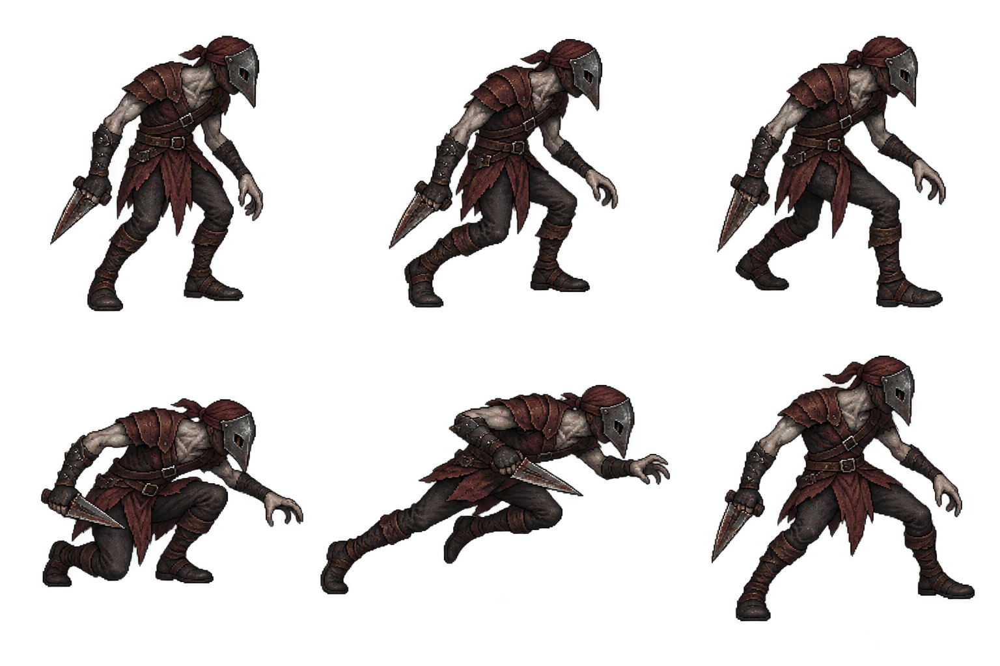

# 매복 사냥꾼 디자인 패키지 v1

2026-10-15 · 전체 검토 대기 · 런타임 미반영

실제 기준 src/combat/return-enemies.js: 속도35로 접근,0.85초 예고 후 고정aim으로 속도340(둔화배율 적용)·0.38초 돌진한다. 거리27 미만·벽검사 후 피해18을1회, 회수1.4초/쿨0.8초다. 순간이동·단검 휘두르기·추가 피해는 없다. 이번 시안에서 판정을 바꾸지 않는다.

위 대기/접근A/접근B, 아래 웅크린 준비/낮은 돌진/제동이다. 마른 잿빛 몸·낮은 새부리 철가면·머리천·적갈색 가죽 경갑·역수 삼각단검으로 중갑 부대장과 쌍검 균열 사냥꾼을 구분한다. 같은 가까운 팔에 한 단검만 유지한다. 오라·예고·먼지·잔상은 별도 효과 계획이다.

신규 생성1회, PNG·정확 프롬프트 보존. 돌진은 옆으로 길고 몸이 낮아 독립crop·몸축/발 기준점 정렬이 필요하다. 손가락·역수 파지·발 위치·두 접근 자세의 차이는 실제52px 크기에서 검토 대상이다. 몸 높이52px/발21 기준 제안이며 돌진에서 키가 낮아지는 것은 포즈로 의도했다. 승인 후 이 캐릭터 전체 동작·초상ready/fallback을 한 단위로 연결한다. 테스트·브라우저QA·푸시·배포·공개 확인 미실행.

## 2026-10-15 승인 후 구현
- [매복 사냥꾼 승인안 로컬 구현 완료 / 미검증] 2026-10-15 ㄱㄱ전체승인. v1원본을 ambusher-reference-atlas.png로복사/재생성없음. ambusher-sprite.js 독립6crop·몸52기준(원본420)/발21·접근2/준비/돌진/제동·고정aim좌우·동결·정지초상ready캐시/fallback 연결. pixel-world대체/ready때기존붉은삼각몸장식생략. 기존별도130px방향예고유지(사거리표시아님)/새오라잔상추가없음. 접근35/준비.85/돌진340*.38/거리27피해18 1회·벽검사/회수1.4/쿨.8·저장보상유지/renderer actor변경없음. 서버배포허용·공개QA목록준비만. 정적소스검토만/테스트브라우저QA푸시배포공개확인없음. crop/alpha/발정렬/좌우·역수파지/접근가독성/초상ready·fallback/動결저장재개/actor불변 미검증. pixel-world효과줄이기옵션미전달로접근2자세정지옵션미연결(횡단사수와동일제약). 운영release-20261014-201910-449d0e유지. 현재spritePNG/pixel-world/return/초상/목록/패키지4기록변경/실행중세션차단없음. 귀환3종PNG로컬구현완료이나검증완료아님. 다음로컬커밋후남은대상재확인 또는명시배포때누적검증.
