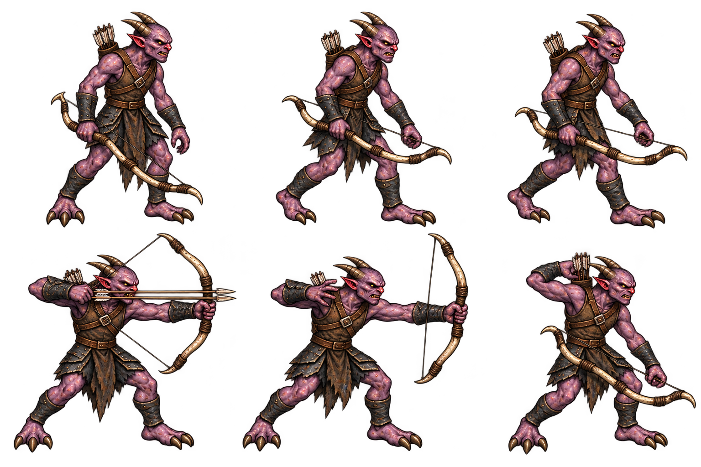

# 악마 사수 디자인 패키지 v1

2026-10-15 · 전체 검토 대기 · 런타임 미반영

실제 demonArcher는 거리260 초과 또는 벽에 가리면 이동42로 접근한다. 사격은 거리에 따른 개시 제한이 없으며, 고정 조준 준비0.65초 후 ±0.14라디안 두 화살을 속도270으로 발사한다. 피해10, escapeDepth4 이상12, 화살 수명4초. 회수0.65초/재사용2.1초. 시안은 행동 수치를 바꾸지 않는다.

위: 대기/걷기A/걷기B. 아래: 두 화살 당기기/발사 직후/화살통에 손을 뻗는 회수. 보라 피부와 짧은 뿔·세 발가락은 병사 계열을 잇고, 가죽 장구·노출 어깨·뼈 복합궁·등 화살통으로 구분한다. 군단장의 냉기·망토·보스 장식은 사용하지 않는다. 예고·화살·잔광·오라는 별도 효과로 연결할 계획이다.

신규 생성1회/원본과 정확 프롬프트 보존. 대기·이동과 사격에서 활을 든 손 방향 차이가 있으며, 군단장 손 방향 허용을 이 캐릭터에 자동 확대하지 않는다. 전체 검토 대상에 포함한다. 당기는 줄·두 화살 파지·손가락·위아래 여백과 독립crop은 승인 후 실제 크기에서 확인해야 한다. 배경처럼 보이는 색만으로 alpha 불량을 단정하지 않는다. 현재 runtime에 반영하지 않았다. 테스트·브라우저QA·푸시·배포·공개 확인은 실행하지 않았다.

## 2026-10-15 승인 후 구현
- [악마 사수 승인안 로컬 구현 완료 / 미검증] 2026-10-15 진행 딱좋다 전체승인(활손방향차이 포함). v1원본을 demon-archer-reference-atlas.png로복사/재생성없음.1536x1024 및 배경표본(0,0)/(500,500) alpha0 메타데이터확인. demon-archer-sprite.js 독립6crop/몸52기준·발21/이동거리걷기2/준비·발사·회수/좌우·동결·효과줄이기·정지초상ready캐시/fallback 연결. recover초반.15초발사/나머지회수로기존시계표시. 별도지면±.14 두조준선230(방향표시이며사거리·벽차단아님). 기존실제두화살발사·이동42·준비.65·속도270·피해10/12·회수.65·쿨2.1·저장·보상변경없음. actor변경없음/서버배포허용·공개QA자산목록준비만. 정적diff검토/메타데이터확인만. crop/상하여백·좌우/파지·걷기/초상ready·fallback·동결/저장재개·사격시점·actor불변은런타임미검증. 테스트·브라우저QA·푸시·배포·공개확인없음. 운영release-20261014-201910-449d0e유지. 현재sprite·PNG·infernal·초상·자산목록·패키지·4기록변경/실행중세션차단없음. 다음로컬커밋후次한캐릭터시안(악마부대장등)또는명시배포때누적검증.
