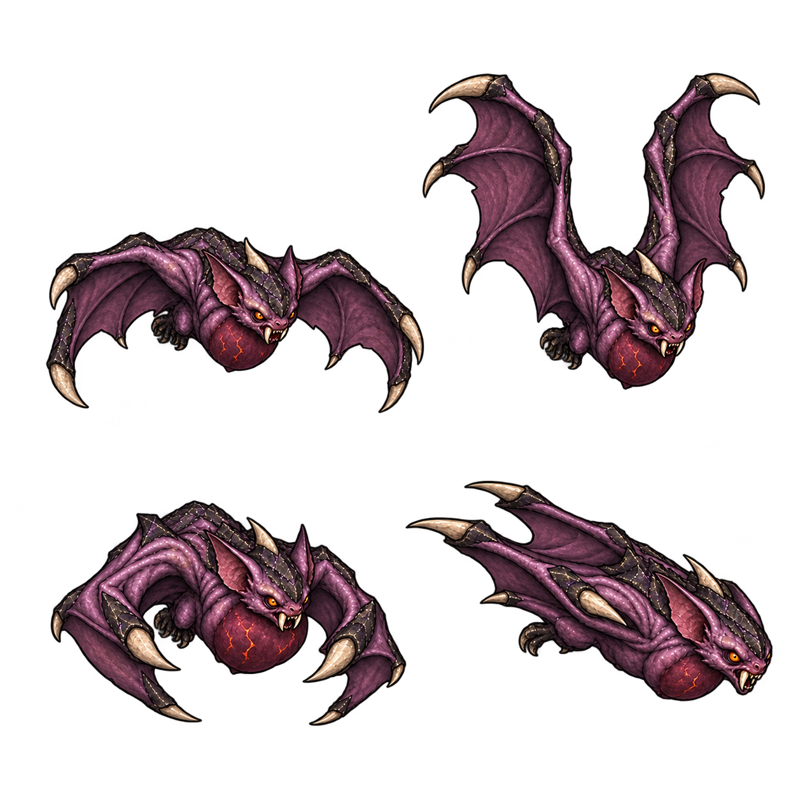

# 폭렬 박쥐 디자인 패키지 v1

2026-10-15 · 신규 디자인 일괄 검토 대기 · 런타임 미반영

## 역할과 동작

실제 기준: `src/combat/infernal-enemies.js`의 `demonBat`. 속도 145로 접근하고 거리 85 이내에서 0.5초 예고한 뒤, 방향을 고정하여 속도 340으로 0.34초 돌진한다. 충돌 거리 28, 종료 폭발 거리 48, 피해 12이며 돌진 후 자폭한다. 이번 시안은 이 수치를 바꾸지 않는다.

한 캐릭터를 네 자세로 검토한다. 왼쪽 위는 날개를 펼쳐 내리는 비행, 오른쪽 위는 날개를 올리는 비행, 왼쪽 아래는 날개를 모으며 흉낭이 부푸는 준비, 오른쪽 아래는 날개를 뒤로 접는 돌진이다. 자폭 역할이므로 별도 회수 자세는 제안하지 않는다.

거친 보라색 가죽, 작은 두 눈, 검은 능선과 뼈 날개 끝, 붉은 흉낭으로 악마 계열을 연결한다. 거대한 눈 형태의 기존 부위 몹과 구별한다. 몸 높이 약 52px, 날개 폭 약 100~110px는 승인 후 실제 화면에서 조절할 구현 제안이다.

## 효과 분리와 구현 경계

오라·예고선·점멸·폭발·잔광은 PNG에 넣지 않고 별도 움직이는 효과로 연결한다. 기존 전투 판정과 자폭 시점에 맞추며, 이미지 자체가 새로운 피해나 판정을 만들지 않는다. 현재는 이미지와 설계 문서만 준비했다. 승인 후 런타임 자산 분리·모션 연결·초상·fallback을 한 단위로 진행한다.

## 원본과 제한

`demon-bat-package-v1.png` 및 v2, 각 정확 프롬프트를 보존한다. v1의 손목 단면 같은 등 돌출부와 돌진 오른쪽 잘림을 v2 편집 대상으로 삼았다. 이 패키지는 디자인 시안이며 실제 크기·crop·좌우·공격 시점·초상은 아직 검증하지 않았다. 테스트·브라우저 QA·푸시·배포·공개 확인은 실행하지 않는다.
