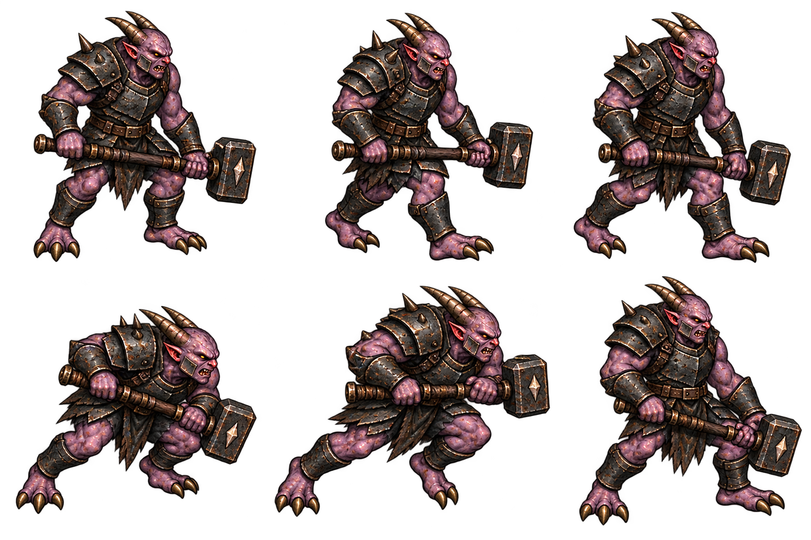

# 악마 부대장 디자인 패키지 v1

2026-10-15 · 전체 검토 대기 · 런타임 미반영

실제 demonCaptain은 이동82로 추격하며 거리260 이내에서 방향을 고정하고0.75초 준비한다. 속도255로0.42초 돌진, 거리40 미만·벽 검사 후 피해18을1회 적용한다. 회수0.8초/재사용2.3초, 지형 이동 반경24다. 무기 휘두르기 판정은 없으며 이번 시안에서도 추가하지 않는다.

위: 대기/걷기A/걷기B. 아래: 낮춘 어깨의 준비/전진 돌진/제동 회수. 병사와 같은 보라 피부·뒤로 난 뿔·세 발가락을 유지하고 흑철 중갑·넓은 어깨·볼 보호대·짧은 양손 전투망치로 구분했다. 왕관·금장·망토·방패는 사용하지 않는다. 망치는 돌진 때 몸 가까이 붙잡는 장비이며 별도 망치 타격을 뜻하지 않는다.

PNG 신규1회, 원본·정확 프롬프트 보존. 자세별 손 파지·양손 연결·세 발가락 및 돌진/준비 차이는 작은 런타임 크기에서 확인해야 한다. 전체를 단순 동일셀로 나누기보다 독립crop과 발기준점을 사용한다. 오라·먼지·돌진잔상·예고는 별도 효과로 연결할 계획이다. 시안 승인 후 이 캐릭터만 모션·초상ready/fallback을 한 단위로 구현한다. 테스트·브라우저QA·푸시·배포·공개 확인은 실행하지 않았다.
