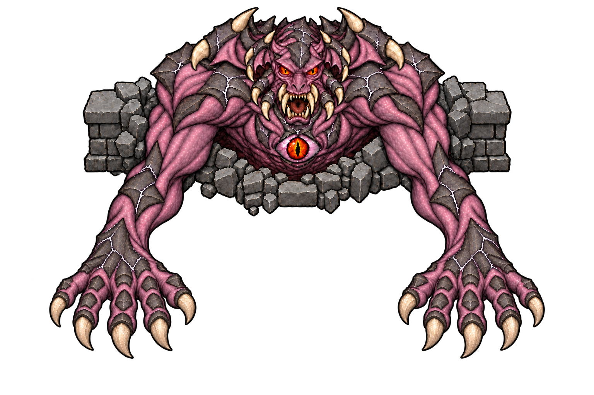
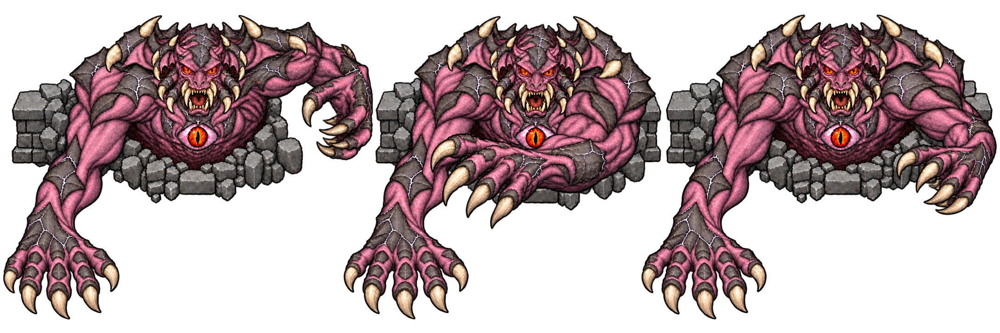
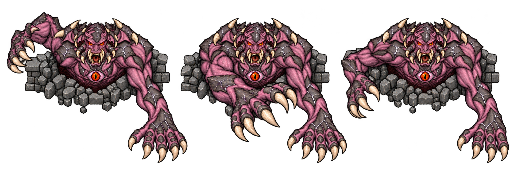
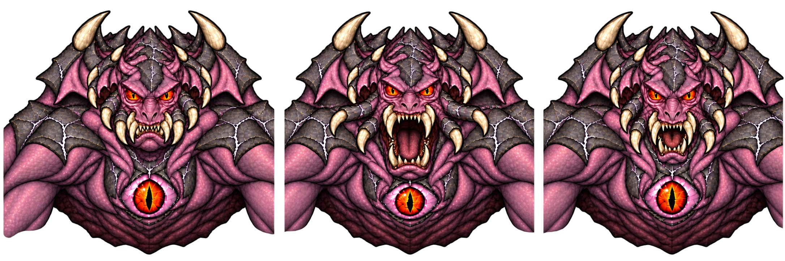
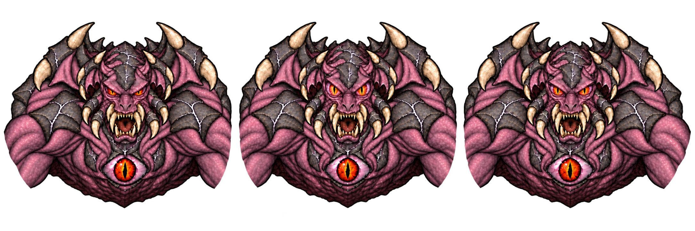
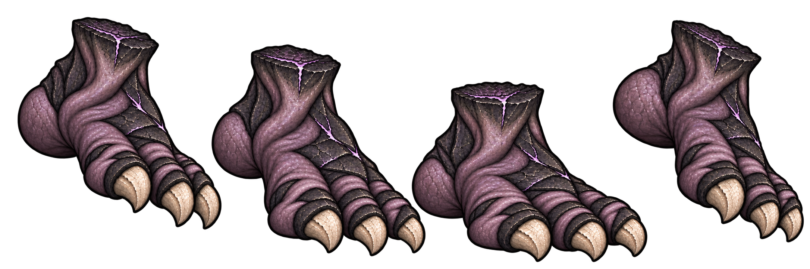

# 대악마 캐릭터 디자인 패키지 v1 — 2026-10-15

캐릭터 한 개의 기본형·공격 모션·별도 효과를 묶어서 검토한다. 2026-10-15 사용자 `ㄱㄱ`로 패키지 방향이 승인되었고, 몸통/표정·팔·벽·발의 분리 자산 제작과 표시 코드 연결을 진행했다. 아래 콘셉트 PNG를 직접 나눠 연결한 것은 아니다. 테스트·브라우저 QA·푸시·배포는 실행하지 않았으며 런타임 표시 품질은 미검증이다.

## 기본형

완전 정면을 향한 상반신이 북쪽 벽을 뚫고 나온다. 카메라는 약간 위에서 내려다본다. 좁고 각진 코, 거미 턱다리와 송곳니, 박쥐 눈의 특징, 보라 피부·검은 능선·뼈 발톱을 통합한다. 긴 팔과 줄인 손 크기, 양손 각각 엄지+네 손가락을 유지한다. 하반신은 벽 뒤에 가린다.

## 공격 모션 묶음

| 공격 | 시안 순서 | 고정할 요소 | 별도 효과 |
|---|---|---|---|
| 보스 왼팔 / 화면 오른쪽 | 밖으로 당김 → 몸 앞 가로 휘두름 → 회수 | 반대팔 대기, 손 다섯 개, 어깨와 벽의 위치 | 공격 예고, 타격 잔상, 피격 효과 |
| 보스 오른팔 / 화면 왼쪽 | 밖으로 당김 → 반대편으로 휘두름 → 회수 | 반대팔 대기, 본체 전체 좌우반전 금지 | 왼팔과 같은 효과를 반대 방향으로 |
| 입 | 턱 조임 → 입·거미 턱다리 확장 → 닫으며 회수 | 눈과 가슴눈 기본 상태 | 흡입/밀어내기, 혀 공격, 탄환은 별도 |
| 얼굴 눈 | 좁혀 조준 → 눈꺼풀 후퇴·동공 수축 → 이완 | 입 기본 상태, 가슴눈 불변 | 충전 발광, 광선/탄환 별도 |
| 세 발가락 발 | 출현·들림 → 하강 → 착지 압축 → 들어 올려 회수 | 동일한 세 발가락과 발목 무늬 | 착지 예고원, 출현/소멸, 먼지·충격파 별도 |

## 모션을 연결하는 기준

- 대기에서 준비로 넘어갈 때 공격 부위의 관절만 움직인다. 반대팔·벽·몸의 기준점은 유지한다.
- 준비는 플레이어가 공격 부위와 방향을 읽을 수 있어야 한다. 타격 프레임 이전에 공격 방향을 확정하는 설계가 필요하다.
- 타격은 한 번 명확하게, 회수는 기본형으로 이어지게 만든다. 회수 도중 준비 자세로 갑자기 바뀌는 연결을 피한다.
- 팔은 회전·팔꿈치 펴짐으로 휘두른다. 손만 평행 이동하거나 팔 길이를 늘려서 구현하지 않는다.
- 발은 착지 전 예고 → 실제 하강 → 접지 → 회수 → 소멸 순서이며, 이동 중 발 그림에 착지 판정을 계속 두지 않는다.
- 얼굴 눈 공격과 가슴눈 공격을 혼동하지 않는다. 이번 눈 시안은 얼굴의 두 눈만 변화한다.
- 공격 시간·범위·피해량은 이번 디자인 문서에서 변경하지 않는다. 기존 본체의 공격 목록은 탄막·발·눈·독길·흡입·혀·심연 탄막이며, 양팔 근접 휘두르기는 새로운 전투 설계가 필요하다.

## 레이어와 효과

배경 파손 벽 → 몸통·머리 → 뒤쪽 팔 → 앞쪽 공격 팔 → 앞쪽 벽 파편 → 별도 공격 효과로 구분한다. 입·눈은 얼굴에 맞춘 프레임 또는 레이어로 연결한다. 오라·흡입·광선·잔상·먼지·충격파를 캐릭터 PNG에 합치지 않는다. 동결·효과 줄이기·정지 초상 표현도 별도로 고려한다.

## 시안 확인 결과와 제작 잔여 항목

이 묶음은 동작 방향을 보는 콘셉트이며, 정렬된 실제 애니메이션 atlas가 아니다. 지금 PNG를 그대로 나눠 런타임에 연결하지 않는다.

- 기본형: 회갈색 배경 연무가 남아 있다. 몸·벽·효과를 분리한 자산이 필요하다.
- 양팔: 일부 손가락 가림과 끝부분 잘림, 셀별 팔·손 크기 및 벽 위치 차이가 있다. 손가락과 관절을 정리하고 마지막 회수에서 기본형까지 이어지는 프레임이 필요하다.
- 입: 치아·턱다리·코·눈매·가슴눈의 프레임 간 차이와 셀 가장자리 색 번짐이 있다. 발동 방향은 명확하나 같은 얼굴로 정렬해야 한다.
- 눈: 눈꺼풀과 동공 변화가 보이지만 준비/회수 차이는 작다. 가장자리 색 번짐, 얼굴·가슴눈 위치 차이를 정리하고 작은 게임 크기에서 확인해야 한다. 발광은 아직 그리지 않았다.
- 발: 네 자세 모두 세 발톱을 육안으로 확인했다. 발목 높이·발 폭의 차이와 셀 여백을 정리해야 한다. 발 자체가 아니라 별도 위치 이동·출현/소멸과 연결해야 한다.

기존 승인 단계는 다시 묻지 않는다. 이후 수정 사항도 캐릭터 패키지로 묶어서 처리한다. 테스트·브라우저 QA·푸시·배포·공개 확인은 새 명시 배포 지시 전까지 수행하지 않는다.

## 원본과 프롬프트

모든 PNG는 내장 imagegen으로 만들었고 버전별 원본을 보존했다. `prompts-demon-core-*.md`에 정확 프롬프트와 참조 이미지를 기록했다. 이번에는 눈·발 각각 1회 생성했으며 이전 시안은 재생성하지 않았다.

## 승인 후 분리 자산/표시 연결 — 2026-10-15

- `demon-core-body-production-v1.png`: 3×2 몸통/표정 6칸. 대기, 입 준비/발동, 눈 준비/발동, 회수. 몸·가슴눈의 미세한 프레임 간 차이는 남아 있다.
- `demon-core-arm-production-v1.png`: 독립 팔 4자세. 정확한 균등 칸이 아니므로 실제 사각형과 어깨 기준점을 사용한다. 반대팔은 팔 레이어만 반전해 연결하며 몸·얼굴 전체는 반전하지 않는다. 일부 자세의 손가락 가림과 어깨 이음새는 실제 표시에서 확인해야 한다.
- `demon-core-wall-production-v1.png`: 캐릭터 없는 독립 파손 벽. 뒤 벽/앞 아랫돌 부분을 별도 순서로 표시한다.
- `demon-core-foot-production-v1.png`: 출현·하강·착지·회수의 발 4자세. 각 세 발톱을 육안으로 확인했으며 실제 그림 영역에 맞춰 자른다.

각각 내장 imagegen 1회씩 제작했다. 원본/정확 프롬프트와 이전 시안은 보존했다. 배포용 사본은 `assets/images/demon-core-{body,arm,wall,foot}-atlas.png`이다.

배경 색 정정: 미리보기의 회갈색을 보고 연무 잔존으로 기록했지만, v9 및 새 몸통 PNG의 여러 배경 샘플은 알파 0이었다. 투명 픽셀의 RGB색만으로 불투명 연무라고 판단할 수 없다. 이 때문에 배경 제거용 재생성은 하지 않았다. 알파 경계 전수 확인이나 실제 게임 합성 검증은 수행하지 않았다.

`src/rendering/demon-core-sprite.js`에서 기존 공격 객체를 읽고 WeakMap 안에서만 표시 상태를 추적한다. 대기→준비→발동 0.14초→회수 0.34초를 표시하며, 동결 시 표시 시간이 정지한다. 입/눈은 표정, 기존 `hand` 탄막은 양팔 교대 준비·휘두르기·회수 표시로 연결했다. **팔이 움직여도 새로운 근접 피해 판정이 생긴 것은 아니다.** 새 근접 패턴·범위·피해·회피 설계는 여전히 별도 작업이다.

기존 본체 `footJump`의 목표 위치에 발 출현/하강/착지/회수 표시를 연결했다. 피해·시간·범위는 기존 코드 그대로다. 효과 줄이기에서는 큰 수직 이동을 없애고 회수 투명도만 처리한다. 몸·벽·발·팔 및 눈 준비 효과는 분리되어 있으며, 광선·탄막·흡입 등의 기존 전투/지면 효과는 유지한다. 에셋 로딩 실패 시 이전 렌더러로 돌아간다. 초상은 정지 대기 합성을 사용하고 ready 변경 시 다시 그린다.

실제 실행은 하지 않았다. 다음 명시 배포 시 어깨·손목 연결, 공격별 타이밍/좌우/손가락/크롭/앞뒤 가림, 얼굴 동일성/가슴눈, 스톰핑 접지·사라짐, 동결·효과 줄이기·초상 ready·실패 fallback·actor 불변·저장 회귀를 묶어서 검증해야 한다.

## 후속 구현: 실제 양팔 근접 공격 — 2026-10-15

분리 표시 연결 다음 사용자 `ㄱㄱ`에 따라 본체 3단계의 실제 좌우 근접 패턴을 추가했다. 위의 “근접 피해 없음”은 이전 표시 구현 단계의 이력이며, 최신 동작은 아래를 따른다. 테스트·브라우저 QA·푸시·배포는 하지 않았다.

| 항목 | 구현 값/규칙 |
|---|---|
| 패턴 | `coreSweepLeft` / `coreSweepRight`, 해부학적 왼팔은 화면 오른쪽 |
| 선택 | 플레이어가 본체 중심에서 210px 미만이고 본체 y-20보다 아래일 때 기존 후보에 추가. 같은 패턴 연속 선택 제외 |
| 준비 | 0.9초, 시작 시 기준점과 아래 방향 고정, 플레이어를 따라 범위 회전하지 않음 |
| 범위 | 팔별 중심 x±32 / y+12, 반경80px, 아래 방향 중심 총151.2도 부채꼴 |
| 판정 | 플레이어 반경14px 원과 부채꼴의 교차. 원이 걸칠 수 있는 최대 중심 거리는 공격 중심에서94px |
| 벽 | 타격 시 고정 본체 기준점→플레이어와 팔별 중심→플레이어 모두 장애물 재검사 |
| 피해 | 준비 종료 시 9, 한 번만. 발동·회수 표시에서 반복 피해 없음 |
| 모션 | 준비 → 발동0.14초 → 회수0.34초, 이후 다음 일반 공격 가능. 실제 값은 공통 `DEMON_SWEEP`에서 공유 |
| 동결 | 준비와 발동·회수 타이머 정지. 강화 전투에서는 기존 냉기 공격속도 계수 적용 |
| 저장 | 준비 공격의 종류/소유자/시간/고정방향 검증, `sweepFlash`의 종류/기준점/남은 시간 저장 검증. 발동·회수 재개 시 피해 재실행 안함 |
| 초기화 | 패턴 초기화·단계 전환·보스 사망·특수공격 정리 시 발동/회수 상태 제거 |

공통 기하 `src/combat/demon-sweep.js`를 피해 판정과 지면 예고가 함께 사용한다. `src/rendering/demon-sweep.js`에서 예고와 발동 궤적을 별도 표시한다. 캐릭터 PNG에 이펙트를 합치지 않았다. 기존 `hand` 탄막은 유지하고, 팔 휘두르기 모션은 새 근접 패턴에만 연결했다. 기존 특수 환경 공격과의 중첩은 유지한다. 원정 도감 설명도 추가했다. 초기 반경116 계획은 정적 좌표 검토에서 손끝보다 넓어질 우려가 있어80으로 줄였고, 타격 자세의 팔을 어깨 기준 -0.5rad 회전시켜 앞쪽으로 뻗도록 조정했다. 실제 모션과 피격 범위 일치는 아직 실행 미검증이다.

이번 단계는 구현·정적 소스 검토만 완료했다. 다음 명시 배포 때 다음을 포함해 누적 변경을 묶어서 검증해야 한다.

- 좌우 선택과 기존 원거리 후보/재현 가능한 난수·단계1/2 회귀.
- 앞/뒤/반경80+플레이어14 경계/각도 양쪽 경계/엄폐벽과 새로 생긴 장애물.
- 준비 중 범위 밖 도주, 방향 고정, 큰 dt에서도 타격1회, 발동·회수 중 중복 피해 없음.
- 동결/해제 및 냉기 속도, 회수 중 다음 일반 공격 시작 방지, 환경 특수공격 중첩.
- 준비/발동/회수 각각 저장 재개, 구버전 저장 허용, 잘못된 소유자/단계/시간/동시 공격 상태 거절.
- 모션 좌우와 예고·실제 피해 일치, 실제 손끝·팔과 범위의 표시 적합성, 효과 줄이기/초상/fallback/actor 불변.

## 후속 마무리: 입·눈·스톰핑 전투 시계 동기화 — 2026-10-15

다음 사용자 `ㄱㄱ`에 따라 본체 일반 공격의 모션도 전투 상태에서 직접 읽도록 변경했다. 렌더러의 WeakMap에서 “직전 공격 객체가 사라지면 발동”이라고 추측하던 코드를 제거했다. 공격을 취소하면 발동 모션이 새로 생기지 않고, 중간에 렌더러가 로딩되거나 저장을 재개해도 남은 준비/발동/회수 시간을 읽는다.

- `a.windup`에 시작 준비 시간을 기록한다. 구버전 저장에는 없어도 기존 종류·압력형 여부의 기본 시간으로 표시한다.
- 본체 일반 공격이 실제로 resolve될 때 `coreFlash`에 종류·기준점·목표점·조준·남은 시간0.48초를 남긴다. 피해와 탄환 생성은 resolve에서만 수행하며 flash 표시에서는 재실행하지 않는다.
- `demon-core-motion.js`의 순수 `demonCorePose`가 준비/발동0.14초/회수0.34초와 진행률을 계산한다. 팔 휘두르기는 기존 `sweepFlash`를 같은 기준으로 읽는다.
- 동결 시 발동/회수 타이머를 정지하고 강화 전투의 냉기 공격속도 계수를 적용한다. 저장 검증은 두 flash의 중복, flash와 다음 일반 공격의 동시 저장, 잘못된 단계·종류·좌표·시간을 거절하도록 확장했다. 초기화·단계 전환·사망·특수 정리 시 상태를 제거한다.
- 스톰핑은 실제 발동의 목표점에 접지 프레임과 별도 착지 고리/작은 먼지를 표시하고 회수·소멸한다. 효과 줄이기는 정지 고리와 발의 투명도 회수만 사용한다. PNG는 재생성하지 않았다.

일반 본체 공격도 회수 완료 전 다음 일반 공격을 시작하지 않도록0.48초를 확보했다. 압력형의 기존 본체 재공격 간격0.35초보다 일부 느려지는 동작 변경이다. 환경 특수 공격과 이미 남은 독길/흡입의 진행은 유지한다. 기존 입·눈·발 피해량·범위와1/2단계의 피해·행동은 바꾸지 않았다. 구형 전투의 본체 준비 공격도 동결 시 정지한다.

실행 검증은 하지 않았다. 다음 명시 배포 때 공격 취소/초기화 직후 가짜 발동 없음, 저장 재개/지연 에셋 ready 시 정확한 단계, 동결/냉기/회수와 다음 공격 간격, 스톰핑 접지-피해-착지 고리 일치 및 효과 줄이기, 구/신 저장·위조 상태 거절과 원래 단계1/2 회귀를 함께 확인해야 한다.

## 분리 발동 효과 마무리 — 2026-10-15

다음 사용자 `다음`에 따라 눈 광선·혀의 발동 효과를 추가했다. 캐릭터 PNG는 재생성하거나 수정하지 않았다. `coreFlash`의 실제 발동0.14초 동안 광선을 표시하고, 혀는 발동 후 남은0.34초에 회수한다. 눈의 발동 발광도 별도 렌더 레이어다. 회수 표시에서 피해를 재적용하지 않는다.

- `demon-attack-shapes.js`가 기존 눈 광선의 반폭15/피해9, 일반3갈래·압력형5갈래, 혀 반경155/반각0.7/피해9를 공유한다. 실제 피해 수치는 변경하지 않았다.
- 광선 예고선과 발동 광선은 장애물을2px 확장한 사각형에 대한 첫 교차점에서 끝난다. 피해는 기존 플레이어 방향 선분 벽 검사 그대로다.
- 혀는 실제 범위의 부채꼴을 예고하고, 중앙 혀를 별도 표시한다. 예전850px 중심 예고선은 실제155px 범위와 달라 제거했다. 부채꼴은25개 방사선으로 벽까지 거리를 계산한 근사 다각형이다. 실제 피해의 반경·각도·벽 검사는 그대로 유지한다.
- 효과 줄이기는 광선 밝기와 혀 폭을 줄인다. 발동·회수 시간은 저장된 전투 시계에서 읽어 동결/재개와 함께 움직인다.

기본형·양팔 근접·입·눈·발의 요청 패키지에 대한 로컬 구현을 여기까지 마무리했다. **검증 완료나 배포 완료를 뜻하지 않는다.** 광선/혀 시작점은 기존 지면 전투 기준점을 따른다. 높은 얼굴 그림과 발사 지점의 시각적 연결, 장애물 모서리의 광선 두께와 혀 다각형 근사, 합성 순서/효과 대비/환경 공격 중첩은 실제 게임 확인이 남아 있다. 다음 명시 배포 때 누적 범위와 함께 검증한다.
