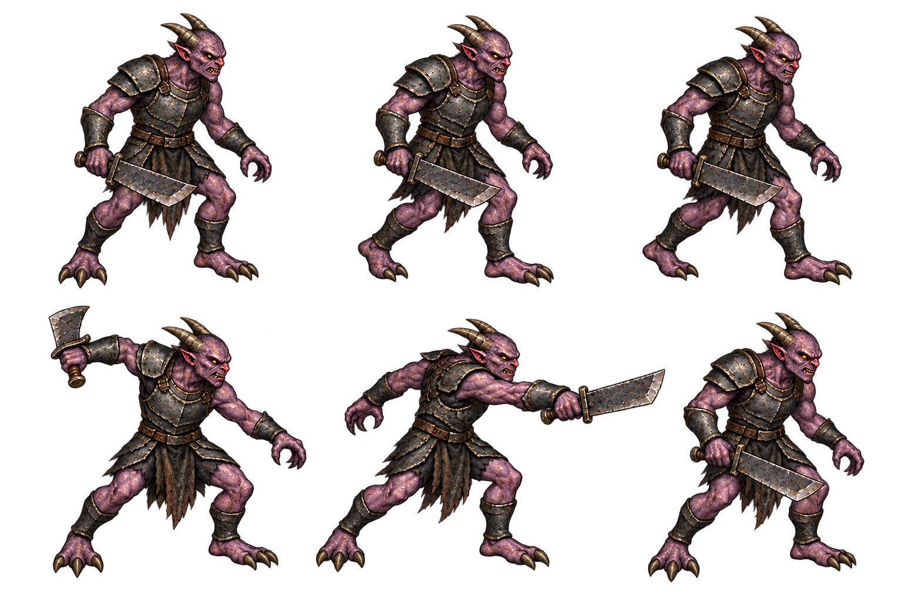

# 악마 병사 디자인 패키지 v1

2026-10-15 · 전체 검토 대기 · 런타임 미반영

실제 기준은 src/combat/infernal-enemies.js의 demonSoldier다. 이동68, 거리85 이내 준비0.65초, 발동 시 거리72 미만·고정 조준과 각도차1.05 미만·벽 검사 후 피해9다. 회수0.65초, 재사용1.6초. 이번 디자인은 수치를 바꾸지 않는다.

보라색 악마 피부·짧은 뿔·흑철 경갑·찢어진 허리천·세 발가락·짧고 넓은 외날검으로 보병을 표현했다. 왕실 갑옷·왕관·방패·할버드·후드는 사용하지 않는다. 위쪽은 대기/걷기A/걷기B, 아래쪽은 준비/베기/회수다. 무기는 큰 어깨갑옷과 팔갑옷이 있는 오른팔에 통일했다. 회전한 공격 자세도 같은 팔로 의도했다.

v1에서 걷기 옆 분리된 칼날과 무기 손 불일치를 발견하여 v2 편집1회로 보완했다. v1/v2와 정확 프롬프트를 모두 보존한다. 베기 칼끝이 옆 셀 쪽으로 길게 뻗으므로 승인 후 비균등 crop과 기준점을 사용해야 한다. 손가락 파지·자세별 어깨/손 연결·걷기 차이는 작은 런타임 크기에서 추가 확인이 필요하다. 배경처럼 보이는 색만으로 alpha 불량을 단정하지 않는다.

예고·검기 잔상·오라·피격 효과는 캐릭터 PNG와 별도로 연결한다. 몸 높이52px/발21 기준은 승인 후 구현하며, 현재는 시안만 준비했다. 승인 시 이 캐릭터의 전체 동작·초상·ready/fallback을 한 단위로 진행한다. 테스트·브라우저 QA·원격 푸시·배포·공개 확인은 실행하지 않았다.
