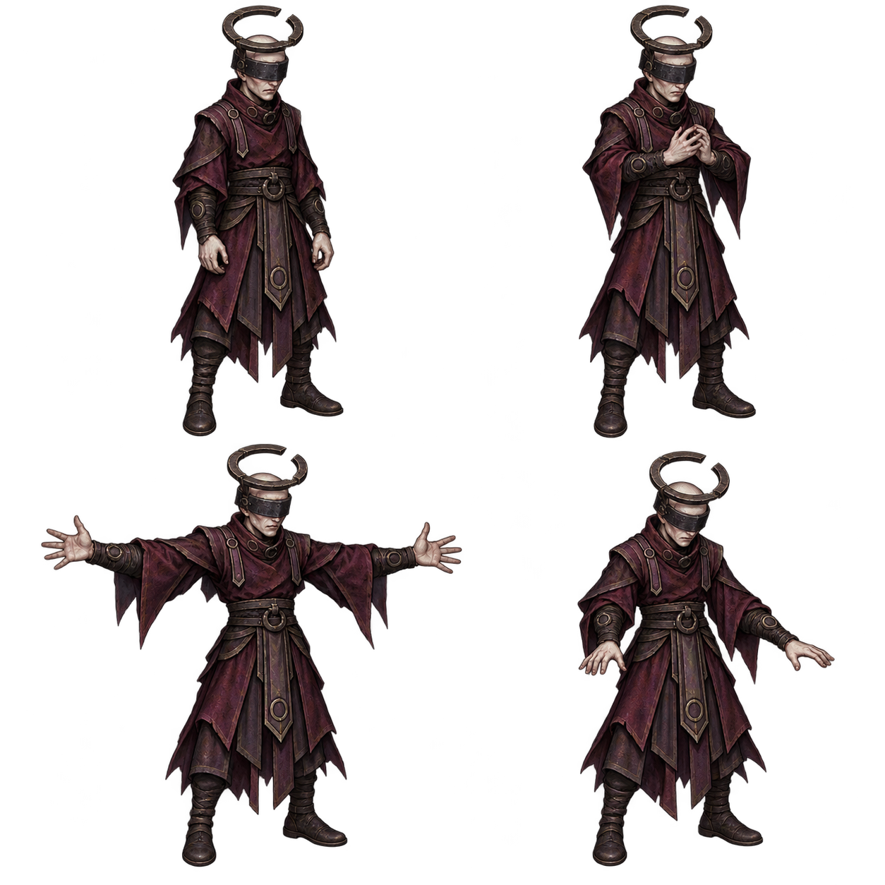

# 고리술사 디자인 패키지 v1

2026-10-15 · 전체 검토 대기 · 런타임 미반영

src/combat/return-enemies.js 기준 고정형이다.0.8초 예고 후 고정aim+i*2π/16(i=2..15)의14탄을 발사한다. 기본115에 attackProfile 속도 배율 적용, 피해10/escapeDepth4 이상12, 회수2.4초 후 쿨다운0.8초다. 이번 디자인에서 이동이나 판정을 추가하지 않는다.

왼쪽 위 대기/오른쪽 위 손 모으는 준비/왼쪽 아래 양팔 발동/오른쪽 아래 팔 내리는 회수. 머리띠에 지지대로 연결한 갈라진 철제 원관·눈을 가린 가면·자주색 의식복·손목 원형 장식으로 인력술사와 구분했다. 머리 고리는 발광 오라가 아닌 실물 장비다. 몸52px/발21 구현 기준 제안. 탄막·예고·오라는 PNG와 별도 효과로 연결한다.

신규 생성1회/원본 PNG·정확 프롬프트 보존. 위쪽 원관이 이미지 상단에 가깝고 발동 팔이 셀 경계를 넘으므로 단순 사분할 대신 독립crop/기준점이 필요하다. 발동 손의 손가락·파지 없는 자연스러운 관절은 실제 크기에서 추가 확인 대상이다. 원관의 틈은 시각적 상징이며 실제 탄막 틈 방향은 고정aim에 따른다. 승인 후 이 캐릭터만 전체 동작·초상ready/fallback을 연결한다. 테스트·브라우저QA·푸시·배포·공개확인 미실행.
