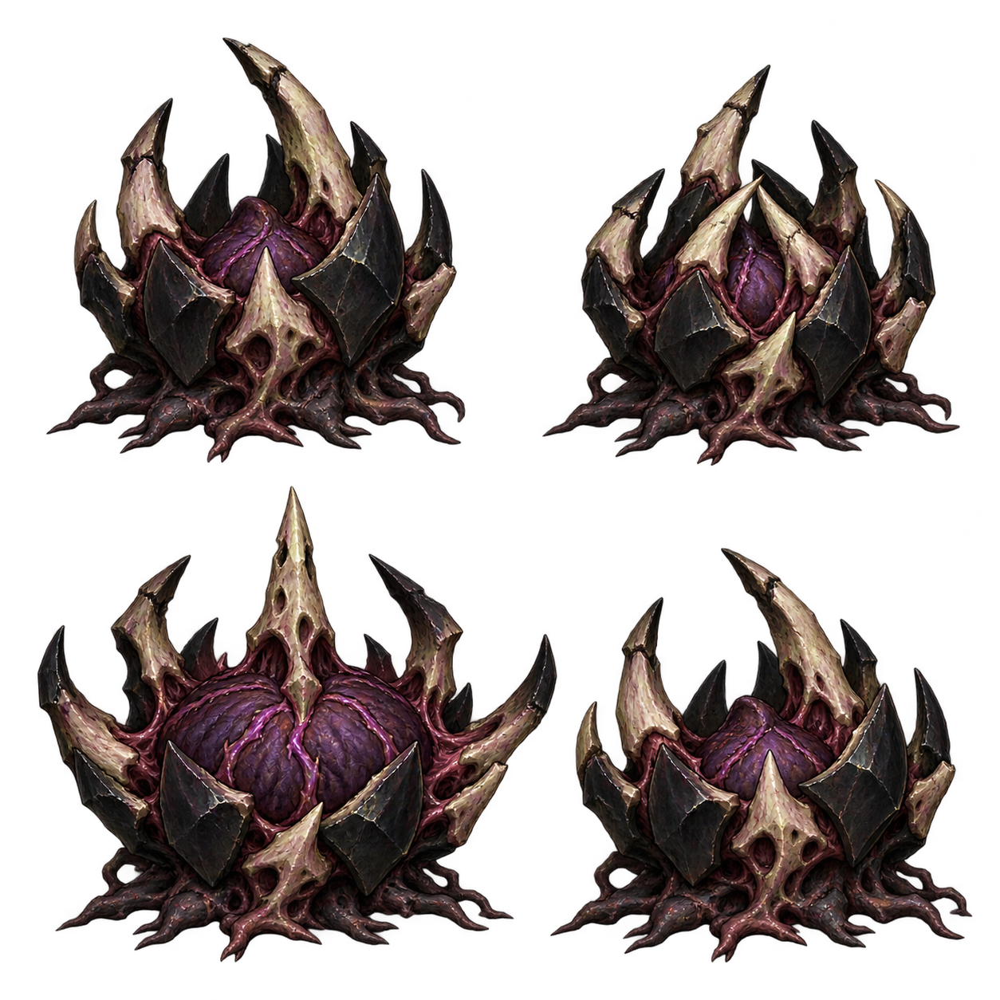

# 심연 가시핵 디자인 패키지 v1

2026-10-15 · 전체 검토 대기 · 런타임 미반영

## 실제 역할

`src/combat/infernal-enemies.js`의 spikeNest는 이동하지 않는다. 플레이어 위치를 한 번 지정하고 벽과 겹치지 않도록 safeSpawn으로 보정한 뒤 0.9초 예고한다. 발동 시 목표점에서 거리34 미만이면 피해9, 회수0.55초, 재사용2.5초다. 몸에서 탄환을 발사하는 적이 아니다. 현재 예고 필드 반경은36이며 실제 피해34와 구별한다. 기존 발동에는 별도 벽 검사가 없으며 이번 시안에서 판정을 바꾸지 않는다.

## 한 캐릭터의 네 자세

왼쪽 위 대기 / 오른쪽 위 핵을 감싸며 수축하는 준비 / 왼쪽 아래 껍질을 펼치고 핵이 부푸는 발동 / 오른쪽 아래 반쯤 닫히는 회수. 검은 흑요석 껍질과 낡은 뼈가시, 보라색 유기핵과 짧은 뿌리로 고정형 악마 생물의 윤곽을 잡았다. 꽃잎·수정기계·얼굴·인간형 팔다리는 사용하지 않는다. 뼈의 구멍은 풍화 표현이며 별도 얼굴로 의도하지 않았다.

본체의 가시는 몸의 수축 동작이다. 실제 공격은 멀리 지정된 바닥에서 발생하므로 예고 링·솟는 가시·회수·파편은 별도 효과로 연결할 계획이다. PNG에는 오라·예고·폭발을 합성하지 않았다.

## 보존과 다음 단계

신규 생성1회. PNG와 정확 프롬프트를 버전별 보존했다. 발동 자세는 다른 자세보다 넓게 펼쳐져 있어 승인 후 독립 crop과 기준점으로 처리해야 한다. 2x2 동일 셀을 단순 분할하면 잘릴 수 있다. 시안 전체 승인 후 이 캐릭터만 runtime 자산·모션·초상·ready/fallback·별도 지면 가시 효과를 연결한다. 기존 행동 수치는 유지한다. 테스트·브라우저 QA·푸시·배포·공개 확인은 실행하지 않았다.
