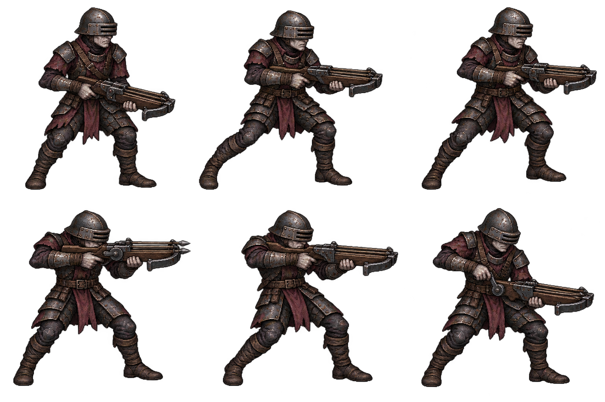

# 횡단 사수 디자인 패키지 v1

2026-10-15 · 전체 검토 대기 · 런타임 미반영

실제 기준 src/combat/return-enemies.js: 플레이어 방향에 직각으로 속도55 이동(둔화 배율),0.8초 예고 후 고정 조준 방향으로 평행3탄 발사. 발사 위치 간격20, 기본속도170에 attackProfile 속도 배율 적용, 피해10/escapeDepth4 이상12. 회수1.25초. 기존 절차형은 활 외형이지만 이번에는 역할을 드러내는 삼중 홈 쇠뇌를 신규 디자인으로 제안한다. 시안 승인 전 동작·무기·자산을 runtime에 반영하지 않는다.

위: 대기/측면 이동A/측면 이동B. 아래: 조준/발사/재장전. 낮은 가로 바이저 투구·창백한 하관·자주색 경갑·감싼 장화·넓게 벌린 다리로 악마 궁병과 구분했다. 삼중 홈 하나의 쇠뇌로 평행 탄막을 표현하며 새 무기 판정을 추가하지 않는다. 예고·화살·오라·잔광은 별도 효과로 연결할 계획이다.

신규1회 생성, PNG·정확 프롬프트 보존. 실제3탄은 본체 기준±20의 서로 떨어진 위치에서 나가므로 쇠뇌 홈간격과 완전히 일치하지 않는다. 작은 크기에서 무기 전후·줄·세 홈/볼트 개수·파지·측면 두 자세의 차이를 검토해야 한다. 무기가 셀 오른쪽으로 길어 독립crop을 사용해야 한다. 몸52px/발21 제안. 테스트·브라우저QA·푸시·배포·공개 확인 미실행.

## 2026-10-15 승인 후 구현
- [횡단 사수 승인안 로컬 구현 완료 / 미검증] 2026-10-15 진행전체승인. v1원본을 strafer-reference-atlas.png로복사/재생성없음. strafer-sprite.js 독립6crop/몸52기준·발21/측면이동2·조준·발사·재장전/최근고정aim기준좌우/초상정지ready캐시/fallback 연결. pixel-world 진입에서대체/기존귀환붉은몸장식은ready때생략. 별도130px평행3예고선 원점±20에맞춤(실제사거리아님). recover1.25중초반.15발사/나머지재장전. 기존55측면이동/준비.8/평행3탄·속도170*profile/피해10/12/회수1.25/쿨.8/저장보상유지. renderer actor변경없음. 서버배포허용·공개QA목록준비만. 정적diff검토만/테스트브라우저QA푸시배포공개확인없음. crop/alpha·발정렬/좌우·초상ready/fallback·동결·파지·측면가독성·actor불변 미검증. pixel-world 경로는effects줄이기옵션을sprite에전달하지않아축소옵션걷기정지별도미연결(새공격효과추가없음), 배포검증때확인. 운영release-20261014-201910-449d0e유지. 현재spritePNG/pixel-world/return/초상/자산목록/패키지4기록변경/실행중세션차단없음. 다음로컬커밋후ringcaster 또는ambusher 한캐릭터시안, 명시배포때누적검증.
