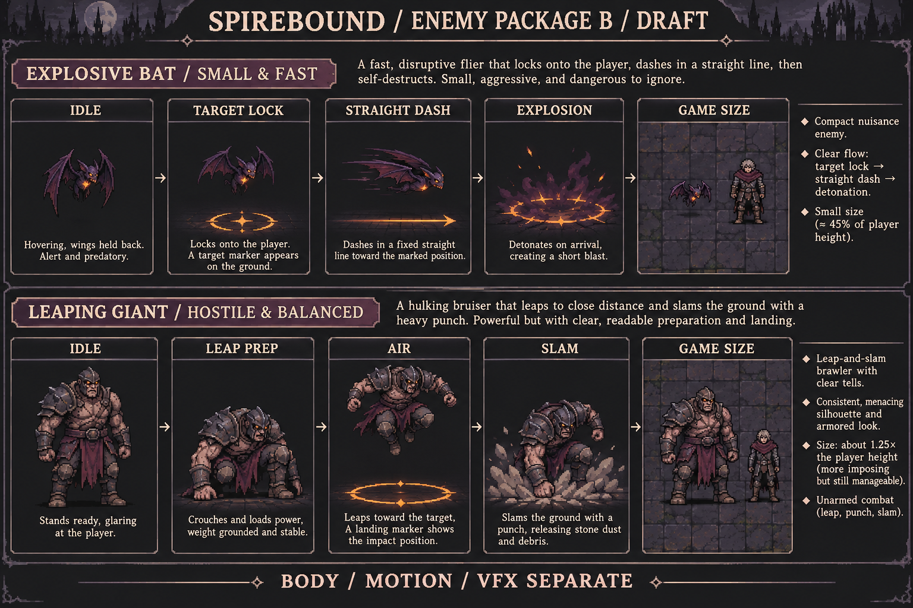

# 3단계 B패키지 — 폭렬 박쥐·도약 거인

2026-11-22. 상태: 외형·모션·효과 시안 준비 완료, 새 디자인 검토 대기. 런타임 미반영.

내장 imagegen으로 만든 컨셉 보드이며 실제 sprite sheet나 게임 캡처가 아니다. 정확 프롬프트는 prompt.txt. 기존 원본/배포 PNG를 바꾸지 않았다.

## 폭렬 박쥐

작은 보라색 공중 적·날렵한 날개와 불씨 중심부. 기본 비행→타깃 지정→방향 고정 직선 돌진→자폭으로 구성한다. 타깃/돌진선/폭발은 몸체와 분리한다. 보드의 주인공 대비45%는 크기 방향 예시이며 게임 치수 확정이 아니다.

구현 초기안은 예고.5초/돌진속도420/폭발반경48, 새 디자인 승인 뒤 실제 크기·피격 반경·벽/종점 충돌·폭발과 함께 조정한다. 기존 낙뢰/탄막과 혼동되지 않는 얇은 주황 예고를 권장한다. 새 원화·동작 반영 전 기존 박쥐는 변경하지 않는다.

마지막 봉인에서 박쥐가 많은 코드 근거는 final-escape.js의 고정 박쥐 중심 소환표다. 원래 사용자 장면/원정 버전은 재현하지 않았다. 6단계의5턴 그림자 보스+일반 적2체 구성으로 교체할 때 이전 박쥐 압박 루프를 제거한다. 이번에 임시로 다른 소환표를 만들었다가 다시 교체하지 않는다.

## 도약 거인

자연스러운 손·팔 비율, 어두운 파손 갑옷·마룬 천·험한 얼굴과 좁은 눈으로 위협적인 인상을 강조했다. 무기는 추가하지 않는다. 기본형→도약 준비→공중→주먹 착지, 착지 원/먼지 파편은 몸체와 분리한다.

시안의 공중 자세와 착지 자세에서 주먹 크기/가면·가슴 갑옷의 세부가 완전히 같지는 않다. 승인 후 실제 자산을 제작할 때 기본형 기준으로 정규화하고 현재 다리/보행·피격 상체 연결 규격과 맞춘다. 본문1.25배는 비교용 크기 예시이며 기존 실제 크기를 임의 확대하는 요청이 아니다.

## 단계 상태

새 외형은 AGENTS.md의 시안 승인 규칙에 따라 검토 후 반영한다. 봉인 추적자/칼드·베라 기존 외형을 사용한 전투 개선과 수문장 보상은 별도 로컬 구현 중이다. 이 보드만으로 모든3단계를 구현 완료했다고 표시하지 않는다. 테스트·브라우저·실기기·푸시·배포는 실행하지 않았다.
