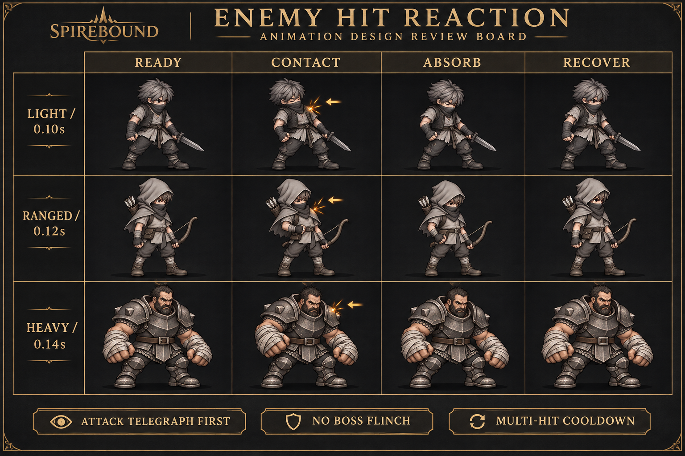

# 적 피격 반응 — 2단계 통합 시안

2026-11-22 사용자 ‘ㄱㄱ’에 따른 다음 작업. 시작 clean `2b73f1f`. 기존 시전 모션 로컬 구현은 보존하며 이번 단계는 새로운 적 동작 패키지의 시안을 먼저 준비했다. 런타임/배포용 자산은 변경하지 않았다.

## 제안

|구분|접점 → 흡수 → 복귀|목표 시간/강도|
|---|---|---|
|경량 근접|가슴/어깨를 피격 방향 반대로 조금 젖힘 → 상체가 따라옴 → 기본 자세|약0.10초, 발/실제 좌표 고정|
|궁수 등 원거리|활을 내려 든 상태에서 어깨를 움츠리고 팔꿈치를 접음 → 짧게 버팀 → 복귀|약0.12초, 조준·발사 중에는 생략|
|덩치 일반 적|갑옷 접점과 작은 어깨 반동 → 무게로 버팀 → 복귀|약0.14초, 몸 이동·압축은 경량보다 작게|

보드는 일반 명중의 자세 차이를 보여준다. 기존 외형/체격을 유지하며 새 무기·피·오라를 추가하지 않는다. 실제 게임 크기의 명확함은 제작 후 별도 검증해야 한다. 상체를 크게 젖히거나 점프/발 미끄러짐/통째 흰색 점멸로 타격감을 대신하지 않는다. 현재 개념 보드를 잘라 production atlas로 사용하지 않는다.

## 우선순위와 범위

- **보스·관문·추적자:** 기존 피격 움찔 생략 유지. 별도 체력 감소 표시/기존 접점은 유지하며 왕 피격 포즈를 되살리지 않는다. 일반 적인 brute와 하강 pursuer를 같은 대상으로 취급하지 않는다.
- **공격 예고/시전/돌진/공중/빙결:** 피격 몸동작보다 우선한다. 공격 중 피격됐다는 이유로 조준·무기 위치/경고 영역을 바꾸지 않는다. 현재 `ordinaryThreat`와 hazard 소유자 판정을 보존한다.
- **연타:** 현재 개체별0.24초 제한을 기반으로 하며 활성 반응 중 재시작하지 않는다. 반복 틱/동일 공격 묶음을 새 큰 반동으로 만들지 않는다. 프레임마다 반응 대기열을 쌓지 않는다.
- **치명/강한 명중:** 실제 피해 사건으로 구분할 수 있을 때만 1회 강조한다. 기존 `beforeRatio-afterRatio>=.08`은 체력 손실량일 뿐 치명타가 아니므로 혼동하지 않는다. 작은 체력 적이 매번 큰 움찔을 하는 것도 줄인다. 치명 접점/문구는 기존 시스템을 재사용한다.
- **완화 설정:** 새 몸 반응은 생략하고 현재 명중/체력 감소 증거를 유지한다. 신규 화면 흔들기·멈춤·공격 경직을 추가하지 않는다.

## 실제 코드에서 확인한 점

`ordinary-presentation-state.js`의 현재 반응은 경량·궁수·덩치 모두 발 앵커 공통 스케일이다. 일반0.09초/큰 손실0.14초, 0.24초 cooldown이며 공격 중 반응을 생략한다. 꽃은 뿌리 고정 때문에 body 변형을 별도 생략한다. `notifyOrdinaryHits`는 pursuer/지원3종/죽은 적을 제외한다. 보스·관문은 `isOrdinary`에서 제외한다. 일반 적 타입24개 회귀가 이미 있으므로 임의로 그 범위를 모두 바꾸지 않는다.

`enemyHitEffects`는 한 스텝의 HP 감소를 hit effect로 만들며 현재 방향/치명 정보를 직접 보유하지 않는다. 반응은 우선 실제 HP 감소와 연결하고, 별도 피해 사건을 연결할 때에만 신뢰 가능한 방향·직격/지속/치명 여부를 복사한다. 플레이어 현재 위치로 모든 타격 방향을 추정하지 않는다. 장판/소환/낙뢰/도트에는 근거 없는 수평 반동을 넣지 않는다. 데이터가 없으면 작은 중립 접점으로 안전하게 복귀한다.

`mergeEnemyFeedback`는 연타 때 flash 수명을 재시작하지 않고 HP 감소 증거만 갱신한다. 이 장치를 새 몸 반응 때문에 제거하지 않는다. `game.js skill()`의 즉시 명중 통지와 `update()`의 stepRun 후 통지를 함께 다뤄야 한다.

## 승인된 방향의 본제작 순서

1. 대표3종의 기존 외형 기준으로 준비/접점/흡수/복귀 및 필요한 보행 상체를 한 패키지로 제작·검토한다. 발/허리 기준과 좌우 명중을 함께 준비한다.
2. 반응 프로필을 view 모듈에 분리하고 보스 제외/위협 우선/연타 cooldown을 유지한다. 개체 WeakMap에만 뷰 상태를 두며 좌표·AI·피해량·판정·저장 필드를 쓰지 않는다.
3. 기존 hit effect/실피해 기록을 필요한 경우 최소 메타데이터로 잇고, 별도 기존 치명 접점을 중복하지 않는다. 지원 몬스터/꽃/공중/기관은 해당 실루엣과 전용 모션을 보존한다.
4. 관련 회귀를 준비하고 기록·로컬 커밋한다. 명시 배포 지시 후에만 전체/개체 반응·예고·연타·구저장·죽음·정지/보행·좌우·모바일·완화·cold/fail을 실제 검증한다.

현재는 시안 완료이며 런타임 구현·효과 체감 검증 완료가 아니다. 후속3 스킬별 타격감, 4 사용 안내로 범위를 넓히지 않았다. 프로젝트 AGENTS.md의 ‘시안을 먼저 보여주고 사용자 컨펌을 받은 안만 구현·로컬 커밋’ 규칙을 적용해 본제작 전 패키지 방향 확인이 남아 있다.

## 제작 기록

내장 image_gen 사용. 입력3종 atlas를 직접 보고 동일 캐릭터 참고로 전달했다. 결과3행×4단계·원래 의상/무기·고정 발/작은 접점과 하단 우선순위 문구를 직접 검토했다. 정지 개념도이므로 보행 레이어/실게임 크기/연속 모션/성능을 확인한 것으로 표시하지 않는다. 새 테스트·구문 실행·서버·브라우저·푸시·배포 없음.

원본은 CODEX generated_images 대화 폴더의 `exec-d5a82b73-d6c2-4bf0-8b9f-2ca3b383e0ac.png`이며 복사본 `package-v1.png`는 무변환 보존한다. 정확한 프롬프트는 [prompt-v1.txt](prompt-v1.txt).
