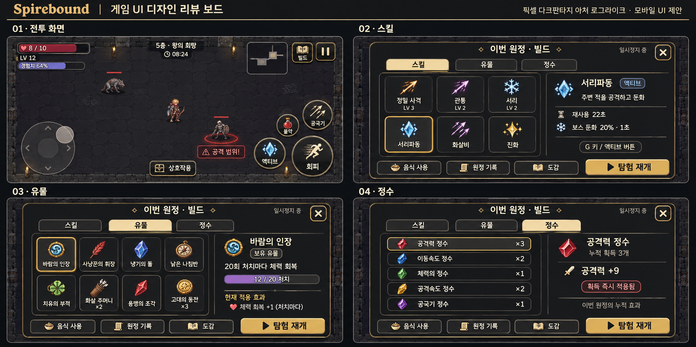

# 넓은 HUD·빌드 3탭 — 시안 v1 검토 메모

2026-11-22. 사용자 ‘시작하자’에 따라 우선계획의 첫 단계인 통합 시안을 준비했다. **외형 확인 대기, 런타임 구현 전**이다.

## 이번 시안에서 확인할 방향

전투는 좌우 상시 목록을 없애 던전이 가용 화면을 채운다. 좌상단 체력/레벨/XP, 우상단 지도/빌드/일시정지, 좌하단 자유 위치 조이스틱, 우하단 회피/액티브/궁극기/물약, 가까운 오브젝트가 있을 때만 하단 상호작용을 둔다. 중앙 문구는 최소화한다. 골드 테두리·픽셀 아이콘·짙은 패널로 기존 주인공/던전과 톤을 맞춘다.

빌드는 하나의 창에서 스킬/유물/정수를 전환한다. 좌측 목록, 우측 선택 상세, 하단 공통 음식/원정 기록·도감/탐험 재개. 열려 있는 동안 전투·타이머·쿨다운이 멈춘다는 기존 가방 의미를 유지한다. 닫기 ×와 재개는 같은 안전 복귀 경로를 쓴다. 탭/아이템을 바꾸는 동작이 보상 지급·스킬 재추첨·음식 소비를 발생시키지 않는다.

## 이미지 예시와 실제 구현의 구분

- 이미지의 유물 이름/아이콘/중첩 배지 일부는 배치 예시다. 새 유물/세트 효과를 추가한 것이 아니다. 실제 `relicInfo`, `ownedRelics`, `relicStateText`, 아이콘 데이터를 연결하고 존재하지 않는 이름은 사용하지 않는다. 수량은 실제 중첩 가능한 항목에서만 표시한다.
- ‘진화’ 카드는 새 스킬이 아니다. 실제 보유 기술의 진화/분기 상태를 설명하는 영역으로 구현한다. 해금되지 않은 궁극기/액티브는 기존 조건을 유지하고 안내만 한다. 스킬 창에서 무료 강화/교체/재배분을 제공하지 않는다.
- 서리파동 설명은 시안에서 축약했다. 실제 상세에는 현행 범위/공격력 계수·일반/보스 둔화·재사용을 데이터로 표시한다. 숫자는 UI 변경으로 바꾸지 않는다.
- 정수 ×3→공격력+9는 현행 공격력 정수 +3의 단순 예시다. ‘누적 획득/즉시 적용’을 표시하고 소비/사용 버튼을 만들지 않는다. 궁극기 쿨다운 등 계산/상한이 있는 효과는 실제 공식을 사용한다. 전체 능력치와 정수 기여를 혼동하지 않게 구분한다.
- 조이스틱이 보이는 위치는 예시다. 기존처럼 왼쪽 영역을 누르는 위치에 생성한다. 고정 조이스틱으로 변경하지 않는다.
- 시안의 ‘공격 범위’ 네모 라벨은 시각 예시다. 매 공격에 새 경고 상자를 추가하지 않고 기존 적 공격 예고/탄막을 보존한다. 체력 바/숫자에도 기존 하트·보호막 의미와 최대치/피해 단위를 유지한다.
- 배경이 실제 960×540 방과 완전히 같은 픽셀/비율은 아니다. 그림은 UI 방향을 보여주는 목업이며 실제 가용 화면 확장/입력 변환·전투 가독성 검증은 구현 뒤 필요하다. 네 화면은 같은 크기의 방을 가정하며 랜덤 방 크기를 이미 구현했다고 하지 않는다.

## 모바일/PC와 조작 규격

- 모바일 가로 844×390을 기준으로 탭/닫기/공통 버튼 최소44px 접촉 영역, 본문 최소14px(주요 수치16px), 노치·홈바 safe-area를 확보한다. 폭 부족 시 패널 바깥이 아닌 목록/상세 내부가 스크롤된다. 긴 설명·최대 보유 목록/빈 목록도 설계에 포함한다.
- 모바일 창은 가용 영역 약92~96%에 들어가고 헤더/탭/재개는 고정한다. 우측 상세가 너무 좁아지는 기기에서는 선택 목록을 작은 카드 행으로 줄이고 상세를 아래로 쌓는 대응을 준비한다. 세로 화면은 기존 가로 회전 안내를 유지한다.
- PC는 같은3탭 구조를 중앙 넓은 패널(대략 최대1040px)에 두고 아이콘 목록/상세 비율을 유지한다. 키보드 플레이의 이동 가능한 중앙 공간은 확보하며 터치 버튼을 불필요하게 띄우지 않는다. I 키로 열고 Escape/닫기/재개로 나간다. 포인터/키보드 힌트는 실제 입력 방식에 맞춘다.
- 탭은 `tablist/tab/tabpanel`, 방향키/Home/End, 선택 상태와 초점 표시를 제공한다. 아이템은 Enter/Space로 선택하고 패널 안에서 초점을 관리한다. 닫으면 게임 Canvas에 초점을 돌려 첫 입력이 원치 않는 시전/이동으로 남지 않게 한다.
- 강제 레벨업/룰렛·유물 선택·엔딩 등 다른 모달을 빌드로 덮거나 건너뛰지 않는다. 현재 `bag()`은 일부 모드만 차단하므로 새 진입 가드를 명확히 정리해야 한다. blur/회전·저장 실패/lease 상실 후 자동 전투 재개를 막는다.
- 음식은 현행 안전 조건/보유/예약 회복을 사용하고 불가 이유를 짧게 보여준다. 원정 기록/도감에서 돌아올 때 선택 탭/스크롤을 유지하되 전투로 자동 재개하지 않는다. 이미 보유한 유물 상세와 새 보상 선택 창은 구분한다.

## 승인 후 구현 단위

1. 빌드3탭 공통 마크업/선택 뷰 모델·기존 데이터 연결/가방 접근 및 모드 복귀·음식/기록·도감 보존. 이 단계는 전투 화면 확장과 분리해서 마감한다.
2. HUD 목록 이전·필수 상태 정리·입력 방식별 조작/미니맵 위치·모바일 safe-area. 이어 캔버스 가용 뷰포트/좌표 변환과 고정 월드/카메라 경계를 정리한다. 단순 CSS 늘리기로 논리 좌표를 왜곡하지 않는다.
3. 방 크기 변주는 별도 월드 규격/저장/문·배치·카메라 시안 단계로 진행한다. 현재 안 승인만으로 기존 원정 전체 재추첨이나 보스방 크기 변경을 포함하지 않는다.
4. 각 단위 문서/로컬 커밋 후, **새 명시 배포 지시 때** 테스트·브라우저·푸시·배포를 묶는다. 현재 턴에는 테스트/구문·서버·브라우저/공개 조회·배포가 없다.

## 생성 이력

imagegen 스킬 내장 도구. 실제 모바일 HUD `docs/qa-package-20261121/entrance/after-auto-844.png`와 실제 Canvas `docs/qa-story-release-20261121/story-verified/integrated-chatter-frame-844.png`를 직접 보고 참조했다. 원본은 `C:/Users/SDSPRO/.codex/generated_images/01a1bb35-6f0c-7421-914b-8beb67028949/exec-3654d06c-b405-4adc-a54d-4397a6ba3934.png`. `package-v1.png`로 무변환 복사했고 정확한 프롬프트는 [prompt-v1.txt](prompt-v1.txt)에 보존했다. 직접 검토 결과 4화면/3탭·상시 목록 제거·정수 즉시 적용 표기는 읽히며, 위 예시/한계는 구현 때 보완해야 한다. 실제 기기/게임 크기/접촉 영역 합격 판정은 아니다.

복사본 SHA256: F90A2B4E82A48ECB7D54CAFEEFDA219B97E1BDC7DED0F91E2AD604FC5961F265.

## 2026-11-22 승인 후 1단계 로컬 반영
사용자가 시안 이미지를 확인하고 ‘ㅇㅋ 진행’으로 승인했다. build-window.js/css 및 game의 기존 bag 연결 완료. 탭/상세/실제데이터·공통 음식/기록/도감/재개·키보드·중단/저장 보호 구현. 정수 궁극기 기여는 1−0.9^n로 표시하고 최종쿨다운과 구분한다. 읽기전용 뷰2회귀 작성/미실행. 현재 HUD 제거·화면확장·방크기변주는 아직 적용하지 않았다. 다음 명시배포 때 새CSS/실제UI·부모overlay의 fixed/모바일 clipping·긴목록/이벤트위임·lease/저장실패·회전·키보드·음식/기록도감복귀를 검증해야 한다. 모양/접촉영역/실제기기 통과로 기록하지 않는다.
