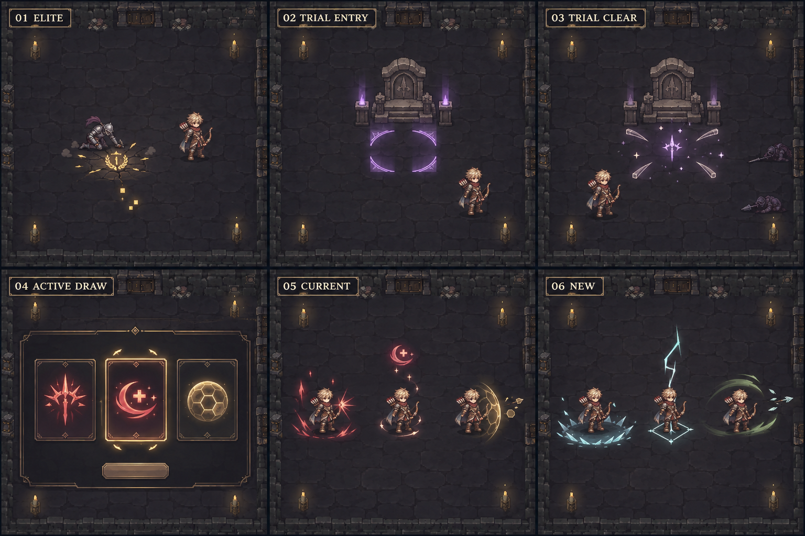

## 2026-11-21 2단계 로컬 구현·미검증
신규3종의전투·저장재개/상태검증·최소전용효과/아이콘을연결해현재6종수동선택가능. 서리둔화는기존빙결수명과분리,뇌격은저장된적바닥고정/방변경취소,장막은일반적탄2개·반사탄/빔/장판제외. 룰렛·기존3종FX마감·엔딩은후속. 신규6회귀작성·미실행/테스트서버푸시배포없음. 아래초기시안/수치표와함께최신WORK_STATUS를따른다.

## 2026-11-21 구현 진행
사용자 ‘다음 진행’으로 패키지 방향 승인. 1단계 정예처치/시련입장·완료 연출을 로컬 구현했다. 시안의 신규3종·룰렛/기존액티브FX·엔딩은 후속이며 아직 구현되지 않았다. 아래 초기 설계의 ‘승인 전’ 표기는 당시 시점을 설명한다. 정적 검토만 완료했고 테스트·서버·푸시·배포는 안 했다.

# 정예·시련·액티브 룰렛 통합 패키지

2026-11-21 사용자 추가 요청 및 답변 **‘신규 3종 + 이펙트, 기존 이펙트도 개선’** 기준. **설계/시안이며 구현·수치 확정 전**이다. 엔딩은 [7초4컷 시안](../ending-quality-20261121/README.md)과 함께 검토할 묶음으로 유지한다.

보드01~03은 정예/시련 입장/시련 완료,04는 룰렛,05는 기존3종,06은 신규3종이다. 정적인 형태·색·강약 시안이며 연속 동작/실제 범위/폰트 크기/성능을 검증한 화면이 아니다. 특히06 가운데 번개가 인물 위로 그려져 있지만 **실제 뇌격은 시전자에게 떨어지지 않고 적이 있던 바닥에 고정**한다. 본 제작에서 대상 적 실루엣·시전자 발동광을 분리한다. 기존 보호막도 반쪽 방패 그림을 그대로 박는 대신 분리 구체·방어 파편으로 맞춘다. 카드 글자/선택등/버튼은 실제 UI에서 구현하며 보드 그림을 인터랙티브 UI 자산으로 사용하지 않는다.

## 실제 현재 구조

- `src/combat/utility.js`: 마혈 각성(HP1 소모/7초 공속+70%, 이동+25%/25초), 혈월의 계약(8초 동안 조건별 회복·최대2하트/30초), 성역의 구체(10초 동안 피격1회 방어/25초). `utilityPanel()`은 세 버튼 중 수동 선택이다.
- `utilityAvailable`: LV5 이상 + 보스1회 처치. 액티브 슬롯1/G키·모바일 버튼. 궁극기 화살비/석궁과는 별도이며 이번 룰렛은 궁극기/일반 레벨업 선택에 적용하지 않는다.
- 제단 시련은 3/5층에서 시작하며 `chooseEvent('trial')`이 시련 용사를 생성한다. `trialReward`에서 보상3택으로 이어진다. 이 **시련 보상 선택은 그대로** 두고 액티브 획득만 무작위 확정으로 바꾼다.
- 정예 죽음/XP분산·보스 전체화면 클리어는 이미 있다. 새 연출을 보상/처치 이벤트로 다시 계산하지 않는다. 특히 `eliteReward`는 첫 물약 보상에 묶여 있으므로 매 정예 처치 FX의 유일한 트리거로 쓰지 않는다.

## 1. 정예 처치 — 작은 휘장 붕괴

적 위치에서 0.45~0.65초: 0.06초 밝은 접점→작은 깨진 휘장/파편6~10개→낮게 퍼지며 소멸. 수호/폭발/포화는 형태를 같게 두고 파편 색/윤곽만 구분한다. 하강 추적자는 같은 계열을 조금 무겁게, 시련 용사는 보라 봉인 파편으로 변형한다. 새 드롭/추가 XP 없음.

보스 전체화면 클리어보다 낮은 강도, 흔들림/히트스톱/입력정지 없음. 방 안에 전투가 남아도 작동한다. 폭발 정예의 **죽은 뒤 실제 피해 예고**는 최우선 재표시하며 황금 파편이 위험 원을 덮지 않는다. 일반 몹·보상 없는 소환체에는 적용하지 않는다. 동시 사망 시 전체효과 예산으로 제한하고 같은 배우의 죽음 FX는 한 번만 낸다.

## 2. 시련 입장·클리어

**입장 약1.1초:** 제단 문양 점등→바닥에 끊어진 보라 원/짧은 기둥→‘봉인된 시련’→전투. 새 장소로 이동하지 않고 현재 방을 사용한다. 이미 만든 적을 정지된 연출 아래 준비한 뒤 기존 입장 유예를 거쳐 시작한다. ‘도전’ 선택을 저장한 뒤 한 번 재생한다. 재개 시 진행 시련의 적을 다시 만들거나 원래 연출을 강제 재생하지 않는다. 정상 스킵/회전·blur/지연·자산 실패로 시련을 건너뛰거나 즉시 공격받지 않도록 기존 pause/resume 흐름을 쓴다. 순수 연출시간에는 게임/기록/쿨다운을 진행하지 않는다.

**완료 약0.9초:** 마지막 용사 처치→흰보라 봉인선 바깥으로 해체/작은 종 한 번→‘시련 돌파’→기존 보상3택. 보스 클리어의 황금 전면파와 구분하고 화면 전체 백색 플래시는 피한다. 클리어/보상 후보를 먼저 저장하며, 연출은 입력·보상 지급의 새 근거가 아니다. 레벨업과 동시 발생하면 시련 상태를 보존해 필요한 성장 선택 뒤 기존 시련 보상 화면으로 복귀한다.

일반·완화 모두 같은 실제 시작/종료 조건을 쓰되 완화에서는 빛/파편/카메라 움직임을 줄인다. 이펙트 자체에는 피해 판정이 없다.

## 3. 액티브 획득 — 3개 중 1개 무작위 확정

**새 원정에서만 새 획득 시 적용**, 이미 획득한 액티브는 유지한다. LV5+보스1 조건과 액티브1슬롯은 유지한다. 신규3종을 포함한6종 중 자격을 만족하는 서로 다른3개를 균등 추첨하고, 그3개 중1개를 각1/3로 확정한다. 영구적으로 사용 불가능한 후보(예: 최대HP1에서 HP소모가 필수인 마혈)는 제외한다. 일시 쿨다운/현재HP만으로 후보를 바꾸지는 않는다. 희귀도·추가 비용·재추첨 상품을 만들지 않는다.

화면: 카드3장 공개→‘추첨 시작’ 한 버튼→테두리 선택등이 빠르게 순환→2.0~2.6초에 감속→당첨 카드 확대 없이 1회 빛/문장 조립→‘획득 완료’. 카드 자체는 선택 버튼이 아니며 정지 타이밍/연타로 결과를 바꿀 수 없다. 후보의 이름/실제 효과는 처음부터 읽을 수 있다. 사용자는 시작과 결과 확인만 한다. 자막은 ‘후보 3개 중 1개를 무작위로 획득합니다’로 명확히 고지한다.

**데이터와 무결성:** 전투 RNG와 분리된 원정/획득 식별자로 후보3개와 당첨 ID를 **처음 화면을 열기 전에 한 번 확정·저장**한다. 애니메이션은 저장된 결과를 보여줄 뿐 추첨하지 않는다. 같은 시드의 기존 뽑기/전투 결과에 영향을 주지 않는다. 세이브 필드 `utilityDraft`(version/후보3/당첨ID/완료 여부) 검증과 구버전 호환을 함께 만든다. 유효하지 않은 후보·중복·당첨 불포함·해금 전 상태를 거부한다.

- 새로고침/일시정지/스킵/회전은 동일 후보/결과로 복구. 연출 스킵은 즉시 그 결과 표시이며 새 추첨이 아니다.
- 첫 저장 실패 시 추첨을 시작하지 않고 저장 오류/재시도를 보여준다. 기존 저장 상태를 버리고 새 후보를 뽑지 않는다.
- 지급은 기존 `chooseUtility` 조건을 이용해 한 번만 적용하고 저장한다. 저장 실패 시 결과 확정 화면을 유지하며 안전하게 재시도한다. 메모리상 이미 같은 액티브면 중복 지급 없이 저장만 재시도하고, 재로드 시 이전 저장의 같은 당첨을 적용한다.
- 기존 액티브/구버전 저장은 강제 재추첨하지 않는다. 기존 미선택 저장에 새 획득 구조를 연결할 때도 해금 상태를 검증한다. 진단/전투 훈련의 빌드 선택에는 룰렛을 끼워 넣지 않는다.

## 4. 신규 액티브 3종 — 수치는 초기 검증안

|스킬|역할/초기 효과안|전용 이펙트|기존 기술과의 차이|
|---|---|---|---|
|서리파동|주변120px 공격력100%·일반 적 이동40%둔화2초, 보스20%·1초. 재사용22초 초안.|발밑에서 얕은 푸른 부채 조각이 바깥으로 전파, 끝에서 작은 얼음결정 소멸. 실제 반경과 일치.|회복/무적이 아닌 근거리 탈출 보조. 보스 연속빙결/공격취소를 새로 보장하지 않음.|
|뇌격인장|가까운 유효 적의 현재 바닥 위치에 고정 표식,0.65초 뒤80px 공격력240% 단발. 재사용28초 초안. 대상 없으면 미사용.|얇은 청백 마름모 고정→짧은 수직 번개→각진 잔광. 표식 후 적을 따라가지 않음.|화살비 지속 범위/석궁 장기 소환과 다른 소형 지연 단발. 치명 판정은 기존 공용 경로1회만.|
|질풍장막|3초 이동+35%, 근접한 일반 적탄 최대2개 소거. 재사용26초 초안.|허리 뒤 얇은 연녹 바람 호/짧은 바닥 잔향, 탄 소거 때 작은 깃 파편.|성역의 구체는 피해 종류와 무관한1회 방어. 장막은 탄만2개이며 빔/장판/돌진/근접을 막거나 구르기 무적을 늘리지 않음.|

의도한 신규 효과가 기존 슬로/중첩 버프·보스면역·치명/출처·탄 소거·저장 재개와 충돌하지 않도록 먼저 구조를 만든다. 공격력/치명은 기존 전투 정의를 사용하고 도트/파생 피해 재치명·추가 보상 루프를 만들지 않는다. 원정 해금·보상 난수는 늘리지 않는다. 신규 타이머/고정 인장/소거 잔여 횟수는 저장·validation·재개에 포함한다. 과도한 밸런스 변경이 필요하면 수치부터 기록해 조정한다.

## 5. 기존 액티브 3종 이펙트 개선

- **마혈 각성:** 발동 시 붉은 짧은 문장/박동→7초 동안 작은 잔광·사격 접점 강조→종료 페이드. HP소모/공속/이속·지속시간은 유지. 몸 PNG에 붉은 오라를 합성하지 않는다.
- **혈월의 계약:** 계약 표시(붉은 반달)→실제 회복이 발생할 때만 적은 입자가 몸으로 귀환→기존 회복 숫자와 함께 소멸. 발동만 했는데 회복된 것처럼 보이지 않게 한다. 피/장기/고어 없음.
- **성역의 구체:** 10초 대기 중 얇은 별도 구체/명암 윤곽→실제 방어 시 작은 육각 파편→시간 만료면 조용한 수축. ‘방어 성공’과 ‘만료’를 색뿐 아니라 형태로 구분한다.

공통 FX 구성요소는 휘장 균열/봉인 개방/시련 클리어/룰렛 선택광/서리 전파/뇌격 각인/바람 탄소거를 필요한 최소 프리셋으로 분리한다. 기존 pixelfx 검토의 시간별 곡선·파편 소멸 접근을 따르되 플러그인 전체 설치·전 효과244개 탑재를 전제하지 않는다. 적 위협과 투사체는 항상 위에 그리고 완화/모바일 상한을 둔다.

## 구현 순서와 검증

1. 이 통합 패키지와 엔딩 시안을 한 번에 확인한다. 승인 전 런타임/배포 자산 미반영.
2. 정예 처치 FX → 시련 시작/완료 토큰·기존 보상 연결. 저장/중단 보호를 먼저 맞춘다.
3. 액티브6종 데이터/신규3종 시뮬레이션·저장·실제 발동 이벤트 → 3후보 룰렛 영속 결과/이중 지급 방지.
4. 기존3종+신규3종 전용 FX·룰렛 연출/모바일·완화 → 승인 엔딩7초 패키지. 의미 단위 기록/로컬 커밋.
5. 별도 배포 지시 때 전체/API·사망동시이벤트/폭발위험가독성·시련레벨업·룰렛저장실패/재로드/연타/스킵/선택분포·신규스킬중첩/치명/보스/무대상/탄종류/저장·엔딩17흐름/PC모바일 부하를 묶어 검증하고 배포한다.

이번에는 코드 읽기·통합 설계/시안 준비만 했다. 테스트·구문 실행·서버·브라우저 QA·원격 푸시·배포는 하지 않았다. 기존 엔딩 시안 승인 대기도 유지한다.

## 생성 이력

내장 `image_gen` 사용. 실제0.59 게임 Canvas 캡처(`story-verified/integrated-chatter-frame-844.png`)와 승인 주인공 앞보행(`entrance-hero-frontwalk-v3.png`)을 직접 확인해 참조했다. 생성 원본 `C:/Users/SDSPRO/.codex/generated_images/01a1bb35-6f0c-7421-914b-8beb67028949/exec-7533d0bb-b58f-4a97-84e5-cf115c222ae0.png`를 보존하고 `package-v1.png`로 무변환 복사했다. 정확한 프롬프트는 [prompt-v1.txt](prompt-v1.txt)에 저장했다. 새 캐릭터/맵 변경 승인을 대체하지 않으며 런타임 PNG/배포목록에 추가하지 않았다.

복사본 SHA256: 27DCC600F9D1AF9E1F7AFDDC9D4CC5FDF0D78B346A59E7B2049A20193A07BF8B.
