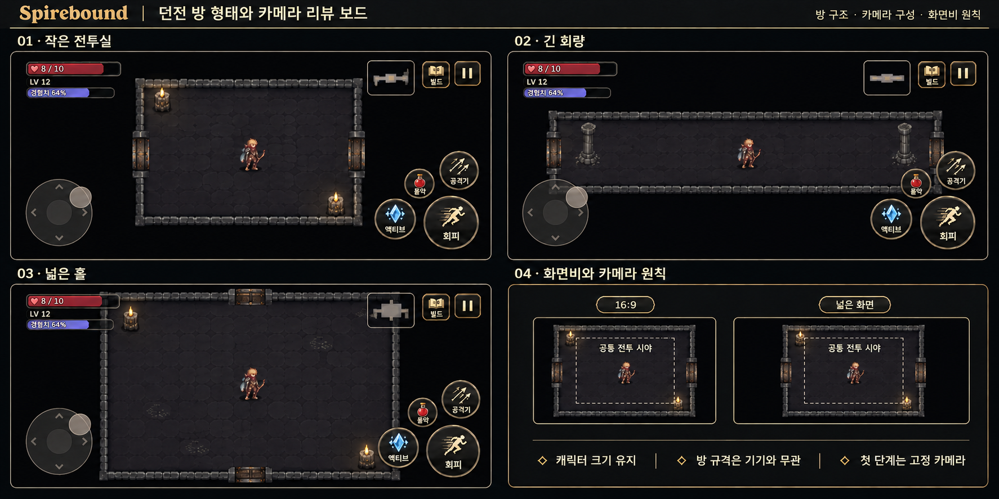
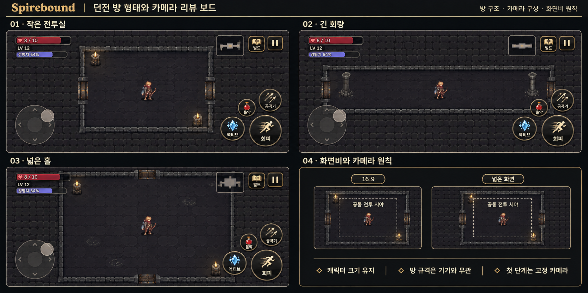

## 2026-11-22 사용자교정 승인·검정외곽 v2
사용자가 방밖 검정을 제안하고 ‘그렇게 진행’으로 짙은 검정+벽가장자리 명암 방향을 승인했다. **현재 기준은 v2 검정 외곽**이다. 아래 v1의 ‘확인 대기/석조 외곽’은 최초 시안 당시 기록이며 현재 외곽 표현에 적용하지 않는다. 같은 방향의 승인을 다시 요청하지 않는다.

외부 반복 석조 무늬는 없애고 #050608에 가까운 균일한 어둠을 사용한다. 방 경계의 실제 벽 한두 겹과 아주 짧은 바깥 그림자만 유지한다. 벽 밖을 통행 가능한 바닥/추가 전투 영역처럼 그리지 않는다. 작은 방일수록 여백이 넓고 큰 홀은 방이 화면을 더 채운다. 캐릭터 배율/기기별 공통 전투 시야/저장 보호·고정카메라 첫 범위는 동일하다. 카메라 외곽 클리어 색과 방 바깥 마스크에 이 팔레트를 적용하는 것이 후속 런타임 작업이다. 아직 게임 렌더에 반영한 것은 아니다.

내장 imagegen에 v1을 직접 보고 수정 입력했다. 정확한 프롬프트는 [prompt-v2-black.txt](prompt-v2-black.txt). 원본 `C:/Users/SDSPRO/.codex/generated_images/01a1bb35-6f0c-7421-914b-8beb67028949/exec-f53aa2eb-58f6-4963-a671-5db73ce1ed71.png`를 무변환 복사. 직접검토에서 외부석조 제거/내부바닥·문·인물·HUD 유지 확인. 실제동작/기하·성능 검증은 아니다.

# 실제 방 외곽·화면비 확장 시안 v1

2026-11-22 사용자 ‘다음 진행’. 승인 UI 후속의 **설계/시안이며 확인 대기**다. 런타임에 방 크기/카메라를 반영하지 않았다. 선행 빌드창/HUD 로컬 구현도 별도 배포 지시 전이다.

## 기존 구현과 이번 차이

이미 `room-shapes.js`에 standard/vertical/horizontal/compact/cross/staggered/maze 7종과 추첨이 있다. 고정960×540 안에서 추가 벽을 배치하고 적을 안전 위치로 옮긴다. `room-layout.js`는 구저장에도 배치를 갱신하며 compact 벽을 다시 적용한다. **랜덤 방 형태가 처음 생기는 것이 아니다.** 이번 안은 이 구조를 재사용/확장하면서 실제 외곽 벽·진입점·전투 경계를 명시해 ‘작은 방/회랑/홀’의 차이를 더 읽히게 하는 방향이다. 기존 십자/엇갈림/미로를 무조건 삭제하지 않는다.

## 첫 범위 제안

|유형|외곽 크기 후보(월드 단위)|특징|
|---|---|---|
|작은 전투실|760×440|낮은 밀도의 장애물, 중앙 회피 공간, 짧은 접근 거리|
|가로 회랑|960×360|좌우 이동 축, 통로 폭 확보, 가장자리 기둥|
|넓은 홀|960×540|현재 기본 크기, 넓은 전투 공간/소수 기둥|

위는 외곽 벽을 포함한 설계 후보이지 검증된 이동 가능 폭/밸런스가 아니다. 기존 진입점·가장자리 제외 폭을 뺀 실제 내부 영역은 별도 정의한다. 보드의 축소 비율은 유형 차이를 강조한 개념도이며 정확한760×440 도면이 아니다. 캐릭터/타일 크기는 코드상 고정 배율을 기준으로 검증해야 한다.

우선 새로 시작하는 원정의 적격 일반방(`type==='normal'`)부터 검토한다. 튜토리얼/관문·보스/계단/출구·시설/특수조우 전용 배치는 보존한다. 회랑은 좌우 연결과 맞는 방부터 적용하고, 상하·다중 문 연결이 필요한 곳은 홀/기존 배치로 대체하거나 별도 문 전실을 설계한다. 기존 일반방 추첨과 합쳐 분포를 정리해야 하며 새로운 확률/RNG 소비를 즉석에서 추가하지 않는다.

이 단계의 홀은 현재 기본 방 크기다. 1200px 이상 큰 홀/스크롤 회랑/추적 카메라는 후속 제안으로 남긴다. 먼저 최소 공통 시야 안에 들어오는 방에서 문·경계·예고를 검증한다. ‘넓은 화면’ 제안이 큰 스크롤 월드까지 이미 구현/승인됐다는 뜻은 아니다.

## 카메라/화면비

최소 공통 전투 시야는960×540을 후보로 유지한다. 방을 중앙에 두고 캐릭터/타일을 방 크기에 맞춰 줌하지 않는다. 화면비가 넓으면 같은 높이 배율에서 좌우 비전투 석조 외곽을 더 그려 검은 여백을 줄인다. 예를 들어844×390은 논리 표시 폭 약1169, 높이540 후보이며 중앙960 범위의 전투 조건은 같다. 실제 출력 크기는 safe-area와 표시 가능한 viewport로 계산해야 한다.

이것은 벽 밖을 이동 가능한 바닥으로 늘리는 방식이 아니다. 작은 방도 외곽 석조/벽의 밝기 차이로 비전투 영역이 명확해야 한다. 평소는 고정 카메라, 강제 흔들림/상시 줌은 추가하지 않는다. 더 좁은 화면은 공통 영역 전체가 보이도록 비율을 유지하고, 기기마다 적 출현/사거리/월드 규모가 바뀌지 않게 한다. 큰 스크롤방을 다루기 전에는 화면 밖 적/탄 공격을 허용하는 설계를 피한다.

## 필요한 코드 경계

1. `roomGeometry(room)` 같은 단일 읽기 인터페이스로 외곽/내부 이동 경계·문 중심/도착점·안전 전실을 모은다. 기존 프로필 없는 방은 현행 규격을 반환한다. 프리뷰와 실제 충돌이 같은 규격을 사용한다.
2. 현재 `doors.js doorArrival/doorFramePoint/entryZone`, `simulation.js`의 이동 전환 임계치와 투사체25..935/40..500 제거, `player-position.js`의31..929/49..491 복구, 장애물/개체 생성·AI/돌진·점프/시설 배치/지면 표식/외곽 벽·미니맵을 확인해야 한다. 보이는 벽만 안쪽으로 당겨도 진입/탄이 옛 경계를 쓰는 문제를 막는다.
3. 연결된 두 방은 추상 지도 이웃이므로 문 위치는 공유 정규화 비율을 각 방 외곽에 투영하는 안을 검토한다. 현행 절대 문 좌표/기존 pair 검증을 바꿀 경우 양쪽 연결/도착 안전지대를 함께 검증한다. 모든 방에 같은 절대 위치를 복사하지 않는다.
4. 방 프로필은 생성 시 결정해 저장하고 재입장/새로고침 때 재추첨하지 않는다. 기존 배치 갱신이 새 외곽을 덮어쓰지 않게 버전 규칙을 분리한다. 새 필드를 모르는 기존 저장은 현 규격을 유지한다. 이번 지시만으로 진행 중인 원정을 일괄 재배치하지 않는다.
5. 프로필/배치 결정은 전투·보상/치명 난수에 영향을 주지 않게 독립 흐름을 검토한다. 기존 난수 순서/규격 저장 검사와 호환이 필요하다. 새 단순 추첨 함수를 기존 7종과 중복 호출하지 않는다.
6. 출입/목표/전투 위치의 경로와 적 간격·회피 공간을 확보하지 못하면 생성 단계에서 기본 규격으로 fallback한다. 진행 중인 적/보상을 임의로 삭제해 작은 방에 맞추지 않는다. 작은 방에서도 포위·폭발/돌진/시련/거대 추적자가 안전하게 동작할 수 있는지 먼저 확인한다.
7. Canvas는 게임 월드 변환과 화면/HUD 변환을 구분한다. HP/수치·보스 UI/이벤트 자막·미니맵/전환/별도 컷신을 월드 확대와 함께 이동시키지 않는다. 현재 게임의 고정960×540 렌더 전체를 무턱대고 확대하지 않는다. 입력은 현행 키/조이스틱 벡터이며, 이후 화면 좌표를 쓰는 입력은 동일 역변환을 사용한다.

## 승인 후 구현 순서

기존7종/배치·문/RNG 저장 규칙 상세 정리 → 기본값을 유지하는 기하/카메라 변환 기반 → 외곽 석조까지 가용화면 렌더 → 적격 새 일반방의 소수 프로필 적용/진입·경로 → 저장/구버전/배치 갱신 연결 순서. 기존 UI/HUD 수정과 의미 단위로 커밋하고, **새 명시 배포 지시 때** 테스트/서버·브라우저·푸시·배포를 묶는다. 화면비/표시 크기·모바일 예고/가림/경계충돌·문 왕복/재로드·적 탄/돌진/점프/XP·시설 접근·카메라 상태복원/컷신을 검증해야 한다.

## 생성 이력과 제약

imagegen 스킬의 내장 도구로 승인 UI 보드와 실제 게임 Canvas를 직접 보고 참조했다. 정확한 프롬프트는 [prompt-v1.txt](prompt-v1.txt). 원본 `C:/Users/SDSPRO/.codex/generated_images/01a1bb35-6f0c-7421-914b-8beb67028949/exec-bf3e10e9-f653-4aae-8fdf-536028e9fce1.png`를 `package-v1.png`로 무변환 복사했다. SHA256 **8EF9F9A13B371A8B36449933423EDD81B1B9E81AA1A0E42AD97F7637EE0548C3**.

이미지 직접 검토: 벽 외곽/회랑·홀 실루엣은 읽힌다. 작은 방의 비율과 ‘공통 전투 시야’ 도식은 개념 표현으로 정확한 좌표 검증이 아니며, 일부 HUD 크기/기둥·캐릭터 위치는 실제 배치와 다르다. 실제 렌더·연속 이동·접촉 영역·물리 기기·성능 검증 결과가 아니다. 이번 변경은 docs뿐이며 테스트/구문 실행·서버·브라우저/공개 조회·푸시/배포는 하지 않았다.
