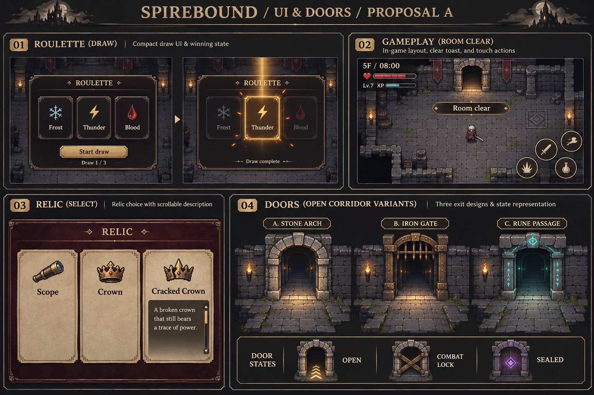

# 1단계 A패키지 — UI·문 시인성

2026-11-22. 상태: 시안 준비 완료·사용자 검토 대기. 런타임 미반영.

사용자 '첫번째부터 구현 진행, 배포는 최종 수정후'에 따라 [개발 계획](../../play-feedback-development-plan-20261122.md)의 1단계부터 착수했다. AGENTS.md의 '시안을 먼저 보여주고 사용자 컨펌을 받은 안만 구현' 규칙에 따라 이번 산출물은 시안·연출 순서·구현 사양이다. 승인 이후 이 패키지를 한 단위로 구현·문서·로컬 커밋한다. 테스트·푸시·배포·공개 검증은 최종 배포 지시까지 실행하지 않는다.

## 이미지 해석과 보존할 요소

- 내장 imagegen으로 만든 방향 비교용 이미지이며 실게임 캡처나 검증 결과가 아니다. 정확 프롬프트는 prompt.txt.
- 기존 한국어·하트 체력 표시·XP·게임 아이콘·모바일 액티브 버튼 위치를 유지한다. 이미지의 체력 막대, 영문 Frost/Thunder/Blood, Draw 1/3, 새 버튼 아이콘·성 장식은 채택 대상이 아니다. 실제 룰렛은1개 당첨/동일 확률이며 이미지의 Draw 1/3은 새 규칙이 아니다.
- 기존 자산은 교체하지 않았다. 문은 콘셉트상 원근이 강하므로 게임 반영 시 실제 top-down 벽 두께/4방향 문틀에 맞춰 단순화한다. 이미지를 그대로 잘라 배포 자산으로 사용하지 않는다.

## 01. 룰렛 여백·당첨 연출

- 후보3개·동일확률·결정된 당첨 결과·시작/건너뛰기/획득 흐름은 유지. 후보를 직접 고르는 기능으로 바꾸지 않는다.
- 제안 크기: PC는 최대900px, 작은 가로 화면은 가용 폭의84~88%·높이의82~86% 이내를 목표로 중앙 배치. 정확 값은 실제 CSS 연결 때 정하며 글자/44px 주요 버튼을 무작정 축소하지 않는다.
- 제목/설명/버튼 여백을 줄이고 카드3개의 높이를 통일한다. 스킬 이름·아이콘은 고정, 긴 설명만 내부 스크롤. 사용 안내는 짧게 남기되 전체 문구 접근 경로를 보존한다.
- 현재 추첨2.4초/효과줄이기.45초는 유지하는 안. 당첨 카드에만 짧은 세로 빛기둥·금색 테두리·바깥 불씨를 적용하며 다른 카드 텍스트는 읽을 수 있는 정도로만 어둡게 한다.

| 시점 | 당첨 연출안 |
|---|---|
| 추첨 중 | 기존 후보 하이라이트가 점차 감속 |
| 당첨0~.12초 | 테두리 밝아짐·카드 내부 중심광 상승(화면 전체 백색 섬광 없음) |
| .12~.45초 | 카드 뒤의 좁은 빛기둥·불씨10~14개 외곽으로 방출 |
| .45~.8초 | 불씨 사라짐·약한 금빛 잔광 유지, 당첨명/획득 버튼 항상 읽힘 |
| 효과 줄이기 | 빛기둥·비행 불씨 생략, 고정 테두리와 짧은 밝기 전환 |

시각 연출은 gameplay RNG·추첨 결과를 바꾸지 않는다. DOM 갱신/건너뛰기 후에도 당첨 FX를 반복 재생하거나 보상을 중복 지급하지 않는다. 새 음원은 추가하지 않고 기존 UI 소리를 재사용하는 안이다.

## 02. 시간·안내 토스트

- 시간과 층/방 정보를 체력 위의 왼쪽 정보 영역으로 이동. 상단 중앙은 문이 드러나도록 비운다. 긴 방 이름은 말줄임/전체 접근성 텍스트를 유지하고 정보가 체력에 겹치지 않게 줄을 나눈다.
- 토스트 중심은 전투 영역 가로50%·세로32~35%를 초기안으로 제시. 최대2줄, 폭은 화면55% 또는420px 이내. 작은 가로 화면에서 글자12px 기준을 우선하고 배경은 짙은 반투명으로 한다.
- 클릭/터치를 가로채지 않고, 알림이 없을 때 영역을 남기지 않는다. 보스 대사·메뉴와 겹치는 순간 일반 보상 알림보다 중요 대사를 우선한다. 기존 중요 알림 내용을 임의 삭제하지 않는다.
- 좌측 체력/XP/유물 배치와 우측 빌드/정지/메뉴, 떠다니는 조이스틱·하단 액티브 배치는 기존 선호 유지. 토스트가 실제 주인공/보스 예고를 가리는지의 실화면 확인은 배포 검증 때 수행한다.

## 03. 유물/스킬 설명 내부 스크롤

- 기존 양피지·세 장 카드 가로 비율을 유지. 카드 외곽 높이/이름/아이콘/희귀도는 고정하고 설명+수치 비교/주의사항만 카드 안에서 스크롤한다. 짧은 카드에 불필요한 스크롤바를 만들지 않는다.
- 현재 relic-ui.css의 작은 가로 화면 panel overflow:auto에 의존하지 않도록 내부 flex의 min-height:0과 실제 가용높이를 먼저 잡는다. 숫자 비교가 길어져도 세 카드 바닥은 맞춘다.
- 얇고 대비되는 스크롤 손잡이·하단 흐림으로 내용이 더 있음을 알린다. 텍스트/터치 영역을 충분히 확보하고 단순 클릭/키보드 선택은 기존 동작을 유지한다.
- 카드 전체가 button인 기존 마크업 안에 스크롤 입력을 넣을 때 드래그 종료가 즉시 획득으로 처리되지 않게 한다. 중첩 button을 만들지 않으며 키보드·스크린리더가 설명 전체에 접근할 수 있게 구조를 정한다.
- 보유 유물 펼침은 후보 높이를 늘리는 대신 별도 내부 스크롤 영역/접힘으로 처리한다. 이 영역과 카드 설명 스크롤은 서로 터치를 빼앗지 않게 한다.

## 04. 문·통로 3종과 상태

추천은 세 스타일을 모두 만들고 층의 기존 재질에 맞게 배치하는 안이다. 새 방/지도를 생성하거나 충돌/통과 위치를 바꾸지는 않는다.

| 스타일 | 표현 | 적용 제안 |
|---|---|---|
| A 석조 아치 | 밝은 닳은 돌 문틀·온색 문턱·안쪽으로 이어지는 바닥 | 기본 석조 층 |
| B 철제 관문 | 청동/철 테두리·올라간 철살·밝은 바닥 경계 | 수비/왕성 계열 |
| C 룬 통로 | 기존 돌문틀·절제된 청록 가장자리 룬 | 마법/특수 테마 |

- 공통: 내부가 검더라도 바닥 턱/문틀과 통로 깊이로 출구가 읽혀야 한다. 현재80×35/측면29×70의 기준 영역과 entry zone을 보존하고 문 장식은 통과 영역 밖으로 확장하는 방식부터 검토한다.
- 열림은 바닥의 짧은 빛/방향 표시, 전투 잠김은 물리적인 가로 빗장, 봉인 잠김은 기존 보라 봉인 문양을 사용한다. 색만으로 상태를 구분하지 않는다. 기존 잠금 로직으로 판정하고 새 잠금 조건을 만들지 않는다.
- 코드 근거: roomTorchAnchors는 문 위치와 무관한 모서리 좌표를 반환하고, game.js는 문틀보다 뒤에 drawEnvironmentTorches를 그린다. 겹침 가능성이 있는 구조지만 사용자 장면의 원인을 재현해 확정한 것은 아니다.
- 구현안: 실제 각 문틀/진입 영역으로부터 횃불 장식의 그림 영역과 불빛 중심을 띄운다. 같은 벽의 후보점 중 문에서 충분히 먼 점으로 이동하고 공간이 없으면 해당 장식을 생략한다. 문 위에 횃불을 덧그리는 방식은 피한다. 이동된 장식은 저장/RNG/전투에 영향을 주지 않는다.
- drawRoomDoorGlow는 footprint가 없는 방에서는 그리지 않으므로, 구형 방의 대체 문 표현도 함께 맞춘다. 상하좌우, 기본·확장 캠페인 모든 층의 기존 renderer/아트 fallback을 보존한다.

## 승인 후 구현 범위와 보류 검증

주요 수정 예정: styles/utility-roulette.css, src/ui/utility-roulette.js, styles/relic-ui.css, src/ui/relic-ui.js, styles/combat-hud.css·mobile-hud.css·기존notice규칙, src/ui/hud.js, src/game/game.js, src/rendering/room-exterior.js·pixel-world.js 및 테마별 문 renderer. 상세 diff는 실제 연결 시 최소 범위로 정한다.

정적 검토에서는 설명/DOM·입력·실당첨결과/RNG·Canvas상태복원·문충돌보존을 확인한다. 이번에 테스트/구문검사·서버·브라우저 QA·실기기·공개 조회는 실행하지 않았다. 최종 배포 지시 때 PC1280/모바일844/작은740, 스크롤/오획득, 추첨/건너뛰기/재개·효과줄이기, 4방향 문/테마/횃불·fallback을 누적 검증한다.

현재 수정 파일은 이 시안 PNG/프롬프트/README와 개발계획·4기록뿐이다. 실행 중 명령/세션 없음. 다음 단계는 A패키지 외형·연출에 대한 사용자 검토이며 그 전에 runtime을 수정하지 않는다.
