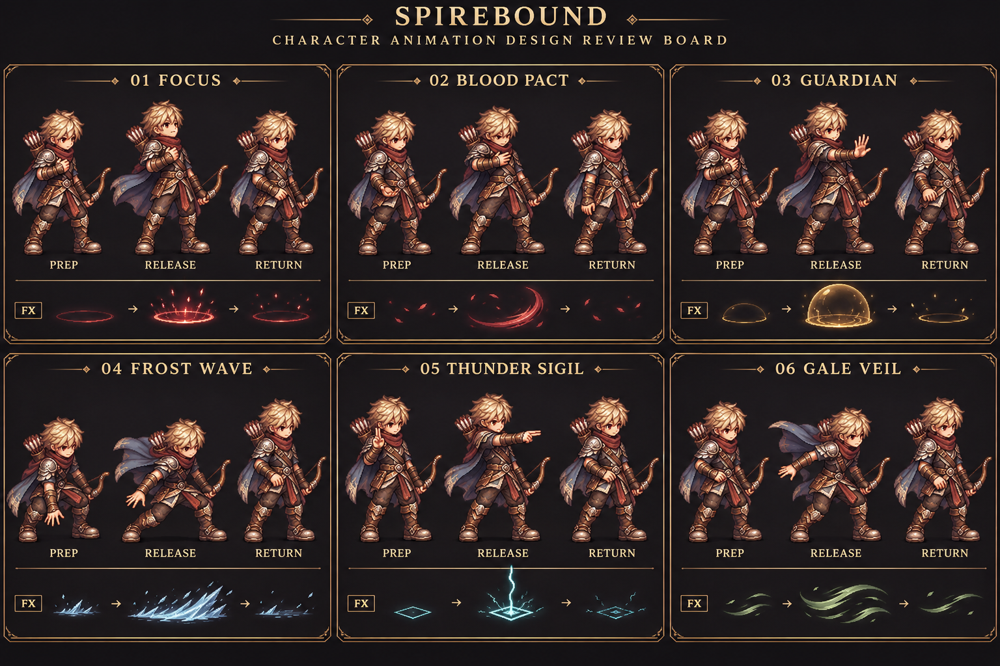

# 액티브 전용 시전 모션 — 1단계 통합 시안

## 2026-11-22 후속: 본제작·로컬 연결 완료, 미검증/미배포

사용자에게 UI 배포와 미완료 시전 모션을 구분해 보고한 뒤 받은 ‘다음 진행’을 기존 6종 시안의 본제작 진행 승인으로 해석했다. 외형 방향을 확장하지 않고 같은 캐릭터/동작 패키지로 제작했다. 아래 최초 시안의 0.60/승인 대기 표기는 당시 기록이며 현재 운영은 0.61(bf276cd)이다.

- 전신 24포즈: [hero-utility-casts-v1.png](../../../assets/images/hero-utility-casts-v1.png).
- 이동용 상체 24포즈: [hero-utility-upper-v1.png](../../../assets/images/hero-utility-upper-v1.png). 몸에 FX를 굽지 않은 독립 상체/망토/활/치마 레이어다.
- 내장 image_gen으로 두 atlas를 별도 생성했다. 원본 무변환 복사, 각1024×1536·4열×6행, 셀256. 원본 파일 이름은 각각 exec-75b47126-5693-4958-b8c0-87e2b77b3a79.png, exec-1f06c25b-d071-4662-ab7d-181d88bd3894.png이며 공통 CODEX generated_images 대화 폴더에 보존했다. [정확한 프롬프트](production-prompts-v1.txt).
- 생성 결과를 직접 보고 금발/목천/가죽/견갑/활·화살통, 여섯 행의 주먹/열린손/전방밀기/아래쓸기/지목/뒤쓸기, 전신 접지/상체 무다리 구성을 검토했다. 파일 크기·alpha 여백(모서리/중간 간격0)도 정적으로 확인했다. 실제58px 게임 합성의 허리 이음·좌우·모션 가독성은 아직 검증하지 않았다.

`hero-cast-state.js`는 성공한 castUtility의 id만 받고 WeakMap에 시전뷰를 저장한다. 일반0.38초 4포즈, 완화0.24초 대표 발동/복귀이며 사망·actionStun·구르기/발도·방/층 변경·시계 역행·pause/모달·로드/새원정 때 취소한다. 렌더는 토큰을 읽기만 하며 원정 저장/전투 난수/HP·쿨다운·실제 스킬/오토 공격 시계를 변경하지 않는다.

`hero-cast-art.js`는 전신/상체를 게임 크기48개 작은 Canvas로 캐시한다. 정지에는 전신, 이동에는 기본 걷기의 다리 영역과 별도 제작한 상체를 겹친다. 다리는 belt y=-4와 x=-14..18 영역을 의도적으로 분리하며 기존 상체를 잘라 새 시전 포즈로 속이지 않는다. 상체 소스의 벨트180을 월드-4에 정렬했다. 손동작 중 활시위 그림만 생략되지만 탄환은 정상 발생한다. 이음새/기존 하체와 옷 크기 일치/프레임별 미세 흔들림은 다음 배포 QA에서 확인해야 한다.

두 PNG는 층 팩의 optional extra로 요청하되 필수 로딩 성공 조건에는 넣지 않는다. cold/실패/차원 불일치/캐시 실패 시 기존 heroSprite가 표시되므로 입장 자체를 막지 않는다. 다음 시전부터 준비된 포즈를 쓴다. 배포 스크립트 파일 허용 목록만 준비했으며 스크립트를 실행하지 않았다.

회귀4개는 작성만 했다. 새 명시 배포 시 상태 회귀/기존 전체, 실제6종 성공·실패·정지·보행/좌우·사격/회피 동시·완화·pause/로드/방전환·cold/fail, 모바일58px 합성·메모리/캐시와 기존FX 가림을 묶어 검증한다. 현재 단계에서 연속 애니메이션/실게임 합격이라고 표시하지 않는다.

2026-11-22 사용자 ‘하나씩 하자 시작’. 제안 1 시전 모션 → 2 적 피격 반응 → 3 스킬별 타격감 → 4 사용 안내 중 **1만 착수**했다. 디자인 확인 전 문서/시안만 준비했고 런타임 소스·배포 자산은 변경하지 않았다. 0.60 운영 유지.

## 동작 방향

승인 주인공의 금발/목천/가죽/짧은 망토·체격을 유지한다. 왼손 활은 내려 잡고, 오른손과 어깨/체중/망토로 발동 실루엣을 만든다. 오라·빛·파편은 몸 PNG에 합성하지 않는다. 시안의 FX 아래 줄은 현재 효과와 동작의 연결 설명이며 새 광역 피해나 범위 변경 제안이 아니다.

|스킬|준비 → 발동 → 복귀|실제 효과와 연결|
|---|---|---|
|마혈 각성|가슴에 주먹 → 흉곽/어깨를 펴며 힘을 모음 → 활 준비|성공 시전의 붉은 박동/유지 오라, HP 소모 현행 유지|
|혈월의 계약|허리 앞 손바닥 → 가슴 앞 반달을 그리는 손 → 손 내림|붉은 반달; 실제 HP 증가 때만 회복 입자|
|성역의 구체|가슴 앞 손 → 열린 손바닥을 앞으로 밀기 → 팔 접기|기존 별도 금빛 구체; 소환 캐릭터/날개 추가 없음|
|서리파동|몸 낮춤/손 내림 → 바깥 아래로 쓸기 → 일어남|현행 반경120의 발밑 파동; 활로 땅을 찍지 않음|
|뇌격인장|어깨 앞 두 손가락 → 적 바닥을 가리킴 → 팔 접기|시전자 모션/발동광과 적 바닥 고정 표식 분리; 실제 0.65초 낙뢰 유지|
|질풍장막|무릎을 살짝 굽힘 → 팔을 뒤로 쓸며 망토 들림 → 준비|현행 바람 오라; 새 돌진/점프/무적 추가 없음|

## 현 코드와 구현 경계

`hero-sprite.js`는 idle/두 walk/shot 4캐시만 가지고 `heroFrameIndex`가 recoil/이동을 고른다. 성공 시전은 `game.js utility()`→`castUtility` 반환 id에서 시전 FX/음향을 만든다. 여기의 **성공 사건만** 독립 뷰 토큰으로 받아 전용 포즈를 재생한다. 실패 버튼/만료/저장 재개가 새 시전 동작을 만들면 안 된다.

- 현재 판정은 버튼 성공 즉시다. 시안의 ‘준비’는 새 선딜이 아니라 성공 직후의 짧은 몸 압축 키포즈다. 예: 0~0.04초 압축 → 0.04~0.18초 발동 자세 → 0.18~0.34초 복귀. 실제 피해/버프·기존 FX 시작/HP·쿨다운/공속·오토 사격 시계는 지연하지 않는다. 최종 프레임 간격은 구현 후 배포 QA에서 확인한다.
- 새로운 actionStun/행동 잠금/히트스톱을 넣지 않는다. 이동·회피·발도 입력 즉시 유지. 회피/발도·사망·실제 행동불가/방·층 전환 시 뷰 토큰을 취소하며, 배경 탭/로드 때 재생하지 않는다. 렌더에서 전투 상태나 저장 필드를 쓰지 않는다.
- 정지 때는 고정 발 앵커의 몸 포즈를 사용한다. 이동 중에는 기존 보행 하체를 유지하고 시전 상체만 덮는 별도 레이어가 필요하다. 서리의 깊은 웅크림/질풍의 하체 벌림은 정지형 전용으로 두고 이동형은 골반 기준을 고정해 미끄러짐을 피한다. 원본을 런타임에서 무작정 잘라 팔·허리에 틈을 만드는 방식으로 완료 처리하지 않는다.
- 짧은 시전 상체는 기본 사격 이미지보다 우선하되 오토 사격과 탄환 판정은 계속된다. 이 짧은 구간에는 개별 활시위 모션이 생략될 수 있다. 구르기/발도 이미지가 시전보다 우선한다. 기존 조준 방향/좌우 반전 및 논리 좌표/그림자 앵커 유지.
- 완화 설정은 작은 대표 발동/복귀 자세와 짧은 망토 반응으로 줄인다. 캐릭터를 키우거나 화면 전체를 흔들어 시전을 대신하지 않는다.

## 승인 후 본제작 순서

1. 같은 주인공 기준으로 6종 준비/발동/복귀·연결 4프레임(24)과 이동 중 사용 가능한 상체 분리본을 한 패키지로 제작한다. 활 왼손/오른 어깨 화살통/체격·얼굴/골반·발 기준을 검토한다. 시안 보드는 production atlas로 잘라 쓰지 않는다.
2. 별도 hero cast 뷰 상태/캐시 모듈을 성공 시전과 연결한다. 실패·죽음·방전환/로드·회피·이동·사격 동시 우선순위와 자산 실패 fallback을 함께 구현한다. 자동 발사·피해·저장 형식은 유지한다.
3. 관련 회귀를 준비하고 문서·로컬 커밋까지 마감한다. 별도 배포 지시 전에는 테스트/구문 실행/서버·브라우저/푸시·배포를 하지 않는다.
4. 배포 지시 때 실제 게임의 정지/보행·좌우·사격/회피 동시·6종/완화·PC/모바일·구저장/실패 시전·이미지 cold/fail을 검증한다. 80px 실크기에서 손동작이 읽히는지 확인하고 필요 보정한다.

## 제작/검토 기록

imagegen 스킬의 내장 도구를 사용했다. `assets/images/hero-reference-atlas.png`와 기존 발도 시트를 직접 보고, 생성 입력은 승인 기본 atlas 한 장만 사용했다. 시안의 18키포즈/6종 실루엣·왼손 활/의상·별도 FX를 직접 확인했다. 마혈/혈월 준비 자세가 가까우므로 본제작 때 주먹/손바닥·가슴 반달 이동을 더 구분한다. 질풍은 점프처럼 읽히지 않게 양발 접지 기준을 유지한다. 아직 연속 애니메이션/게임 크기 가독성·합성/성능 검증 결과는 아니다.

원본: `C:/Users/SDSPRO/.codex/generated_images/01a1bb35-6f0c-7421-914b-8beb67028949/exec-ffa8df5c-7acf-405c-8f25-02def29a01e5.png`. `package-v1.png`로 무변환 복사했다. 정확한 프롬프트는 [prompt-v1.txt](prompt-v1.txt). 새 테스트·서버·브라우저·공개 조회/배포 없음.

복사본 SHA256: 61BBBEF90A5DDC06C26856C590B6D2D88AFC5878BD2146A60CCF31494B3066B3.
